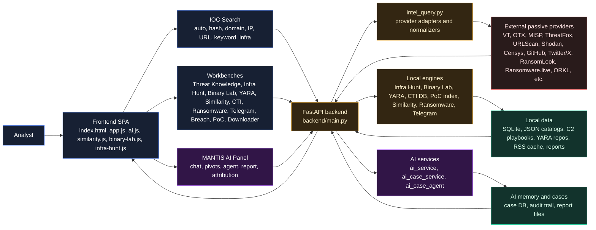
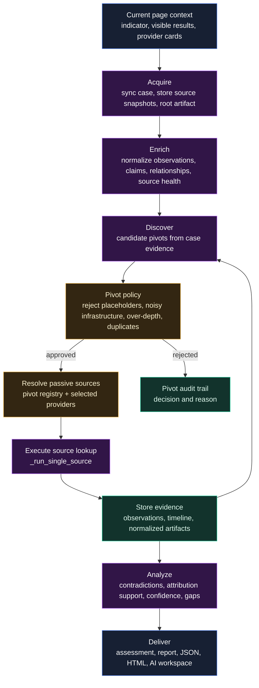

# MANTIS

MANTIS stands for **Multi-source Analysis and Threat Intelligence Search**. **MANTIS** is a threat intelligence workbench for IOC enrichment, OSINT CTI collection, ransomware and breach monitoring, YARA operations, malware similarity analysis, and AI-assisted investigations.

## Highlights

- **IOC Search**: Auto-detect or manually search hashes, domains, IPs, URLs, keywords, and infrastructure targets.
- **MANTIS AI**: Evidence-aware chat, summaries, pivot recommendations, autonomous agent mode, AEAD case workflow, attribution scoring, correlation analysis, YARA assistance, CTI summaries, and report exports.
- **Infrastructure Hunting (Infra Hunt & C2 Catalog)**: Pivot from any seed (IP, domain, ASN, CIDR, cert SHA-256) into adversary infrastructure. Extracts JA4/JARM, TLS certificates, favicon MMH3, and HTTP headers; cross-references 1,000+ curated C2 playbooks (Cobalt Strike, Sliver, Havoc, Metasploit, etc.); correlates across Shodan, Censys, FOFA, Netlas, URLScan, Silent Push, Driftnet, Validin, and Etugen; scores candidates with GreyNoise anti-noise verification, interactive graph visualization, and scheduled recurrence.
- **AI Binary Analysis Lab**: Native (PE, ELF, Mach-O) and managed .NET reverse engineering, dual headless IDA Pro and Ghidra backends, GoReSym symbol recovery, automated function/variable renaming, offline AI workspace export, autonomous in-database investigation, multi-format reporting (HTML, MD, PDF), and 1-click MANTIS case creation.
- **VirusTotal Bulk Samples Downloader**: Batch download malware binaries by MD5, SHA-1, or SHA-256 (up to 50 hashes) directly to local folders via browser File System Access API or create password-protected AES-256 encrypted ZIPs (`infected`), integrated with VT Live Hunt monitoring.
- **Threat Knowledge**: Browse MISP Galaxy threat actors, malware/tools, ransomware, Microsoft Activity Groups, Tidal groups, surveillance vendors, Malpedia families, and Kaspersky TIP actor profiles.
- **MISP Intelligence**: Query a configured MISP instance as a passive, read-only contextual correlation source for IOC events, tags, galaxies, sightings, warning lists, reports, and related indicators.
- **Ransomware Monitor**: Track recent victims, groups, trends, countries, ransom notes, crypto addresses, infrastructure, and watchlists from RansomLook, Ransomware.live, and ThreatLabz notes.
- **YARA Ecosystem**: Explore local YARA repositories, scan samples, validate rules, run corpus/path/upload tests, save workbench rules, and use AI to explain or fix rules.
- **Similarity Engine**: Build entities from samples, extract static and optional IDA/Hex-Rays features, compare samples, inspect functions/blocks/API patterns, and tune thresholds.
- **CTI Articles**: Ingest RSS/CTI feeds, extract IOCs, manage categories and sources, search the local article corpus, and request AI article summaries.
- **Vulnerability Intelligence**: Track CVE/PoC data, CISA KEV context, trending public exploits, and OSV malicious package intelligence.
- **Telegram Toolkit**: Monitor Telegram channels with MTProto, parse stealer logs, track target exposure, manage bot-token investigations, and validate artifacts.
- **X Monitor**: Collect and filter monitored X/Twitter accounts and infosec chatter for emerging IOC and vulnerability leads.
- **Breach Watcher**: Aggregate DailyDarkWeb, RecentBreaches, DataBreach.watch, HaveIBeenPwned, DataBreaches.net, Infostealers Stats, and Leak-Lookup data.
- **Today's Intelligence**: Daily rollup of CTI articles, exploited vulnerabilities, PoCs, ransomware activity, social signals, and optional AI brief/report output.

## Architecture



## MANTIS AI

MANTIS AI is not a generic chatbot bolted onto the UI. It reads compact page context, provider findings, current results, visible text, case state, and analyst-selected evidence. It can then reason about the active investigation while preserving passive/read-only guardrails.

### AI capabilities

- **Assist**: Ask questions about the current result set or investigation page.
- **Summarize Findings**: Convert raw provider cards into concise analyst notes.
- **Recommend Pivots**: Rank passive follow-up actions and suppress noisy pivots.
- **Compare Relationship**: Correlate entities and evidence with overlap/contradiction handling.
- **Attribution**: Score candidate actor/group attribution with evidence categories, contradictions, missing evidence, and confidence bands.
- **Agent Investigation**: Run bounded autonomous next-step selection through approved frontend actions.
- **AEAD Case Run**: Execute Acquire, Enrich, Discover/Pivot, Analyze, and Deliver against case evidence.
- **Report Drafting**: Build case reports, Markdown exports, JSON exports, saved HTML reports, and portable AI workspace ZIPs.
- **YARA Assistant**: Explain rules, analyze validation errors, suggest fixes, auto-fix safe syntax issues, and review test results.
- **CTI AI**: Summarize CTI articles and produce Today's Intelligence AI briefs/reports.
- **Audit and Safety**: Store tool decisions, approval state, operation metadata, and suppressed pivots.

### AEAD workflow



### AI workspace export

**Export AI Workspace** downloads an offline case bundle designed for coding agents and human review. Each ZIP includes `AGENTS.md`, a `CLAUDE.md` pointer, the full normalized `case.json`, focused JSON catalogs, the Markdown report, and portable workflows under `skills/*/SKILL.md` for investigation, evidence review, pivot planning, threat attribution, and report writing. The attribution workflow implements a structured 6-category threat attribution evidence model and adapts its evidence categories and caution rules to MANTIS case data. The export contains no API credentials and its skills prohibit active indicator contact or unsupported enrichment claims.

### Passive pivot registry

The deterministic registry in `backend/ai_pivot_registry.py` maps verified pivot archetypes to existing provider adapters. Current pivot families include:

- Hash pivots: similar samples, network IOCs, YARA matches, family context, behavioral signatures, execution parents.
- Domain pivots: passive DNS, current IPs, certificates, sibling domains, web reputation, threat pulses.
- IP pivots: domains, ASN/BGP, certificates, services/ports, abuse/noise, threat pulses.
- URL pivots: URL telemetry, payload hashes, redirect chains.
- Infrastructure pivots: ASN infrastructure, CIDR exposed hosts, certificate-linked infrastructure.
- Infrastructure Hunt Engine: preview reusable TLS/HTTP/DNS fingerprints before execution; search with Shodan, Censys, FOFA, Netlas, Silent Push, and Driftnet; pivot through Validin and Etugen; validate candidate IPs with GreyNoise; then score, graph, export, and monitor clusters.
- Threat actor pivots: campaigns, infrastructure, ransomware victims.
- Vulnerability pivots: exploits/PoCs and in-the-wild exploitation.
- Malware/social pivots: family samples, social mentions, ThreatFox and MalwareBazaar checks.

## AI Binary Analysis Lab

MANTIS vendors the complete binary analysis engine and exposes it as a first-class web workbench under **Reverse Engineering -> AI Binary Analysis Lab**. The original engine modules and IDAPython runner remain intact; `backend/binary_lab.py` adapts them to persistent MANTIS jobs, progress events, artifacts, settings, and case evidence.

- Discover and queue PE, ELF, Mach-O, IDB/I64, Ghidra projects (GZF/GPR), and managed .NET samples.
- Run native samples through **IDA Pro (headless)** or **Ghidra (headless)** with automatic tool detection and backend selection.
- Rename functions and local variables with address-preserving options.
- Decompile managed assemblies into C#, CIL, metadata, strings, and resources.
- Export AI workspaces with decompiled code, disassembly, headers, catalogs, CFGs, xrefs, globals, imports, strings, and agent instructions.
- Run exported-workspace analysis or in-database autonomous investigation.
- Generate Markdown, HTML, and PDF reports with token budgets and fallback-provider controls.
- Monitor, stop, resume, delete, inspect, and download jobs, then create MANTIS cases from analyzed hashes.

Install `requirements.txt`, confirm the IDA or Ghidra path under **Engine Settings**, and keep **Use MANTIS AI settings** enabled to reuse the configured MANTIS provider securely. Generated files are stored under `backend/data/binary_lab/output/<job_id>/`; uploaded samples remain under `backend/data/binary_lab/uploads/` until the job is deleted.

## Feature Map

```mermaid
flowchart TB
    classDef ai fill:#311547,stroke:#b76cff,color:#ffffff
    classDef nav fill:#172033,stroke:#5b8cff,color:#ffffff
    classDef src fill:#12332c,stroke:#2bd4a3,color:#dfffee

    Home["Home HUD"]:::nav --> IOC["IOC Search"]:::nav
    IOC --> Results["Results, pivots, history, imports, exports"]:::nav
    Results --> AI["MANTIS AI"]:::ai

    IOC --> Sources["Source Selector"]:::src
    Sources --> Free["Free/local sources<br/>crt.sh, RIPEstat, ISC, OpenPhish, PhishStats, ThreatMiner, ORKL, CTI DB, MISP Galaxy"]:::src
    Sources --> Keyed["API-backed sources<br/>VT, OTX, MISP, Abuse.ch, URLScan, Shodan, Censys, Silent Push, Driftnet, Validin, Pulsedive, GitHub, Twitter/X, Kaspersky TIP, Ransomware.live"]:::src

    Home --> Knowledge["Threat Knowledge"]:::nav
    Knowledge --> TA["Threat Actor<br/>MISP, Microsoft, Tidal, Surveillance, Kaspersky"]:::nav
    Knowledge --> MW["Malware and Tools<br/>MISP categories and Malpedia"]:::nav
    Knowledge --> Ransom["Ransomware Monitor"]:::nav

    Home --> Infra["Infrastructure Hunt<br/>C2 Playbooks, Fingerprints, Engines, Graph, Monitor"]:::nav
    Home --> Lab["AI Binary Analysis Lab<br/>IDA Pro, Ghidra, GoReSym, ILSpy, AI Workspace"]:::nav
    Home --> Downloader["Samples Downloader<br/>VT Bulk Hash Download, Direct / Encrypted ZIP"]:::nav

    Home --> YARA["YARA<br/>Explorer, Scanner, Workbench"]:::nav
    Home --> Sim["Similarity<br/>Dashboard, Entities, Create, Compare, Settings"]:::nav
    Home --> CTI["CTI Articles<br/>feeds, categories, search, AI summary"]:::nav
    Home --> Vuln["Vulnerability Intelligence<br/>PoC index, KEV, OSV"]:::nav
    Home --> Social["Social and Underground<br/>X Monitor, Telegram Toolkit"]:::nav
    Home --> Breach["Breach Watcher"]:::nav
    Home --> Today["Today's Intelligence"]:::nav
```



## Frontend Navigation

The sidebar is the analyst's main workflow map. Each item opens a focused workbench while keeping pivots, history, settings, and MANTIS AI close to the current evidence.

### Home


The Home page is the entry point to MANTIS. From here, **Click to Enter** opens IOC Search and starts the main investigation workflow.

Returning Home also closes the active workspace and brings the interface back to its initial state.

### IOC Search


IOC Search is where most investigations start. It accepts **hashes, domains, IP addresses, URLs, keywords, and infrastructure queries**, with Auto-Detect available when the indicator type is not specified.

Before running a lookup, analysts can choose which intelligence providers to query. MANTIS collects the results and presents them as provider-specific cards rather than mixing everything into a single verdict.

Depending on the indicator and available sources, results may include reputation, detections, MISP event context, passive DNS, certificates, related infrastructure, malware families, sandbox observations, sightings, and other provider context. Values returned by providers can also be used as pivots for follow-up searches inside MANTIS.

### History Lookups


History Lookups keeps a local record of previous MANTIS searches. It is useful when returning to an IOC investigated earlier or checking what information was available during a previous lookup.

The same section also contains **AI Reports**, where reports generated by MANTIS AI can be reopened or removed.

### Today's Intelligence

Today's Intelligence provides a consolidated view of recent security activity collected by MANTIS.


The page brings together **CTI articles, exploited vulnerabilities, newly published PoCs, ransomware activity, regional signals, and social intelligence**. Results can be filtered by source, severity, country, ransomware group, and collection period.

For a faster review, MANTIS AI can summarize the collected items into a daily brief or generate a more structured intelligence report.

### Threat Actor


Threat Actor provides a searchable reference for known threat actors and activity clusters.

The dataset currently includes information from **MISP, Microsoft Activity Groups, Tidal, surveillance-vendor datasets, and Kaspersky TIP**. Profiles may contain aliases, descriptions, references, associated malware or tools, and other names that can be pivoted back into MANTIS searches.

This view is mainly intended for attribution research and for adding actor context while investigating a campaign.

### Malware & Tools


Malware & Tools is a searchable reference for malware families and tooling seen in threat activity.

Entries are grouped into categories such as **RATs, ransomware, botnets, Android malware, RMM tools, stalkerware, exploit kits, cryptominers, and TDS**, with additional data from MISP Galaxy and Malpedia.

An entry can be used as a starting point for further research into related reports, indicators, samples, YARA rules, and infrastructure.

### Ransomware Monitor


Ransomware Monitor tracks ransomware and extortion activity from several public intelligence sources.

It covers **recent victims, ransomware groups, activity trends, affected countries and sectors, ransom notes, cryptocurrency addresses, infrastructure, detection IOCs, and watchlist matches**.

Data is collected from sources including **RansomLook, Ransomware.live, and ThreatLabz ransomware notes**, then exposed through a common interface for monitoring and investigation.

### YARA


The YARA section provides three separate workflows:

- **Rule Explorer** — search and browse rules from local and synchronized YARA repositories.
- **Sample Scanner** — scan a sample against selected rule collections.
- **Rule Workbench** — write, validate, test, and save YARA rules.

The workbench supports individual files, paths, uploaded samples, and local corpora for testing. MANTIS AI can also explain existing rules, inspect validation errors, and suggest fixes while developing a rule.

### Similarity


Similarity is used to compare malware samples against previously defined malware or threat-actor entities.

Analysts can create entities, attach reference samples, extract static features, and compare new samples against the stored dataset. Features can include **strings, imports/APIs, functions, basic blocks, and other static characteristics**, with optional IDA/Hex-Rays-derived data when available.

The goal is not to automatically attribute a sample. The comparison exposes shared characteristics and similarity evidence that can support manual malware clustering and attribution analysis.

### AI Binary Analysis Lab

The **AI Binary Analysis Lab** provides an integrated reverse-engineering workbench within MANTIS. It supports native binaries (PE, ELF, Mach-O), disassembler databases (IDA `.idb`/`.i64`, Ghidra `.gzf`/`.gpr`), and managed .NET assemblies (`EXE`/`DLL`).

- **Dual Disassembler Backends**: Runs native binaries through headless **IDA Pro** (`idat64`) or headless **Ghidra** (`analyzeHeadless`) with automatic engine detection and backend selection under Engine Settings.
- **Go and .NET Support**: Integrated **GoReSym** restores stripped Go function names, package paths, and types; **ILSpy** (`ilspycmd`) decompiles .NET assemblies into clean C# source trees, metadata, and resources.
- **AI Semantic Renaming**: Renames functions and local variables into meaningful descriptive identifiers while preserving original virtual addresses for easy disassembler correlation.
- **Autonomous Investigation**: Optional multi-pass autonomous analysis loop investigates capabilities (persistence, anti-analysis, C2 beacons, credential dumping) and traces data flow between functions.
- **AI Workspace Bundle**: Generates offline workspaces containing decompiled code, CFGs, linear disassembly, structured JSON catalogs (functions, variables, strings, imports, exports), and agent instruction prompts (`AGENTS.md`).
- **Multi-Format Reporting**: Generates interactive HTML, Markdown, and downloadable PDF reports with executive summaries, MITRE ATT&CK taxonomy mapping, and YARA signature recommendations.
- **Job Navigation**: Multi-tab job inspector features `Queue`, `Analysis`, `Functions`, `Variables`, live streaming `Disassembler Log` (with noise filtering and auto-scroll), `Reports`, `Events`, and an interactive `Artifacts` tree.
- **CTI Case Handoff**: A single click on **Create Case** bridges the analyzed sample's cryptographic hashes and extracted network IOCs directly into a MANTIS CTI Case for external intelligence enrichment.

Detailed guide: [AI Binary Analysis Lab Documentation](docs/ai_binary_lab.md).

### Infrastructure Hunt

The **Infrastructure Hunt Engine** enables proactive adversary infrastructure tracking, C2 discovery, and network asset correlation:

- **Hunter Deck Feature Extraction**: Ingests seed indicators (IP, domain, ASN, CIDR, or certificate SHA-256) and extracts high-fidelity fingerprints including JA4/JA4X, JARM, SSL/TLS certificate attributes, HTTP server banners, Favicon MurmurHash3 (MMH3), HTML `<title>` tags, and open port profiles.
- **Shared Infrastructure Suppression**: Automatically filters multi-tenant CDN/Cloud edge proxies (Cloudflare, Akamai, Fastly, AWS CloudFront, Azure Front Door) to avoid false-positive cluster expansion.
- **Curated C2 Hunting Playbook Catalog**: Ingests over 1,000 proven hunting queries for major C2 frameworks (**Cobalt Strike**, **Sliver**, **Havoc**, **Metasploit**, **Mythic**, **PoshC2**, **Brute Ratel**, **ShadowPad**, **AsyncRAT**, **Redline Stealer**) across Shodan, Censys, FOFA, Netlas, URLScan, and Etugen.
- **Multi-Engine Correlation & Preview**: Generates composite multi-signal queries and executes parallel searches across configured engines.
- **Scoring & GreyNoise Verification**: Evaluates candidate infrastructure nodes with multi-signal corroboration scoring (High, Medium, Low confidence) and verifies IPs against GreyNoise to filter out benign internet scanners.
- **Interactive Graph & Monitor**: Visualizes the seed-to-signal-to-infrastructure graph, exports candidates to CSV/JSON, and saves persistent hunts in `backend/data/infra_hunts.db` for automated scheduled monitoring and infrastructure drift alerts.

Detailed guide: [Infrastructure Hunting Guide](docs/infra_hunting.md).

### VirusTotal Bulk Samples Downloader

The **Samples Downloader** provides high-throughput malware sample acquisition directly from VirusTotal by cryptographic hash:

- **Batch Ingestion**: Accepts up to **50 hashes per execution** (MD5, SHA-1, SHA-256) separated by spaces, commas, semicolons, or newlines.
- **Dual Download Modes**:
  - **Direct to Local Folder**: Uses the modern browser File System Access API (`showDirectoryPicker()`) to stream binaries directly into a chosen folder on disk as `<hash>.bin`, bypassing browser RAM buffering.
  - **Encrypted ZIP Archive**: Packages acquired samples into an AES-256 encrypted archive (`vt_samples_<timestamp>.zip`) with standard security password `infected` to prevent accidental execution.
- **Live Diagnostics & Feedback**: Real-time progress bar, summary counters, and explicit diagnostic error reporting (e.g., 404 Not Found, 401/403 Forbidden, 429 Quota Exceeded, 504 Timeout).
- **Clipboard Helpers**: One-click **Copy Failed** and **Copy Success** buttons for rapid re-querying or incident documentation.
- **Safety Consent Guardrail**: Requires mandatory analyst confirmation before initiating downloads to prevent accidental handling of live malware on non-sandbox workstations.
- **Workflow Integration**: Integrates directly with **VT Monitoring** via one-click "Send to Downloader" buttons, and allows immediate sample handoff into the **AI Binary Analysis Lab**.

Detailed guide: [VirusTotal Bulk Samples Downloader Guide](docs/vt_bulk_downloader.md).

### CTI Articles


CTI Articles is MANTIS's local library of threat-intelligence reporting.

Configured RSS feeds are periodically collected and stored locally together with article metadata and extracted indicators. Analysts can search the archive, filter by source or category, enable or disable feeds, and manually trigger feed synchronization.

Articles can be opened directly inside MANTIS, and MANTIS AI can summarize longer reports into shorter investigation notes.

### Vulnerability Intelligence


Vulnerability Intelligence focuses on the information around a vulnerability rather than just the CVE record.

It combines **PoC availability, trending exploit repositories, CISA KEV data, severity information, references, and OSV malicious-package intelligence**.

This makes it easier to answer practical triage questions such as whether public exploit code exists, whether exploitation has been observed, and what technical references are available for further analysis.

### X Monitor


X Monitor follows selected security researchers, threat-intelligence accounts, and other monitored X/Twitter sources.

Accounts can be added, edited, removed, categorized, and refreshed from the interface. Collected posts can then be reviewed for indicators and investigation context.

The monitor is mainly used to catch information that often appears on social media before it reaches a formal CTI report: **new vulnerabilities, PoCs, malware campaigns, infrastructure, threat-actor activity, and researcher findings**.

### Breach Watcher


Breach Watcher collects information about publicly reported breaches, leaks, and credential exposure.

It combines breach feeds with **RecentBreaches, DataBreach.watch, Have I Been Pwned breach metadata, Infostealers Stats, and Leak-Lookup**. Depending on the source, analysts can review breach names, affected domains, dates, exposed data types, and other available metadata.

Search functions are also available for supported identifiers such as domains, email addresses, usernames, and IP addresses.

### Telegram Toolkit


Telegram Toolkit provides several utilities for collecting and reviewing threat intelligence from Telegram.

**Channel Monitor** uses an authenticated MTProto session to follow configured channels, including sources related to threat actors, hacktivism, ransomware leaks, stealer logs, malware distribution, and CTI.

**Telegram Auth Settings** manages the MTProto session used by the monitor.

**Bot Info** retrieves available information about a Telegram bot from a supplied bot token.

**Dump Messages** collects messages available to a bot and exposes the returned messages and artifacts for analysis.

Where applicable, collected content can be parsed for **IOCs, credentials, archives, victim or target references, and other Telegram artifacts**.

### MANTIS AI


MANTIS AI works on top of the intelligence already collected during an investigation.

Instead of treating the AI panel as a standalone chatbot, MANTIS passes the current investigation context and available source evidence to the model. It can summarize findings, identify relationships, suggest useful passive pivots, review attribution evidence, and generate investigation reports.

For agent-based investigations, the model can also decide which available passive sources are worth querying next and continue the investigation within defined limits.

The analyst still gets the underlying provider results, so AI output can be checked against the evidence it was derived from.


### Settings

Settings centralizes operational configuration. **API Keys** manages provider credentials. **Feeds** controls feed catalog sync and source toggles. **GitHub** stores repositories used by GitHub threat-intel searches. **MANTIS AI** configures the AI provider, model, timeout, and connection test. Settings lets analysts enable richer sources without changing code.


## Backend Modules

| Module | Purpose |
| --- | --- |
| `backend/main.py` | FastAPI app, route registration, startup tasks, static frontend serving. |
| `backend/intel_query.py` | IOC provider adapters, source metadata, normalization, lazy provider helpers. |
| `backend/ai_service.py` | AI settings, chat, summaries, pivots, agent runs, audit, attribution/correlation wrappers, YARA AI wrappers. |
| `backend/ai_case_service.py` | AI case DB, evidence extraction, source execution, AEAD run, reports, exports, related cases. |
| `backend/ai_case_agent.py` | Case hypothesis analysis and next-step planning. |
| `backend/ai_pivot_registry.py` | Passive pivot archetype registry. |
| `backend/ai_pivot_policy.py` | Pivot validation, duplicate/noise rejection, safety bounds. |
| `backend/ai_source_router.py` | Source inventory, source priority, source role, next-source planning. |
| `backend/ai_correlation.py` | Entity feature extraction, overlap evidence, contradiction handling, relationship classification. |
| `backend/ai_attribution.py` | Candidate normalization, evidence scoring, contradiction severity, confidence bands. |
| `backend/ai_yara_assistant.py` | YARA parsing, explain, error analysis, safe fix suggestions, auto-fix validation. |
| `backend/yara_*.py` | YARA repo discovery, engine compilation, scanning, workbench validation/save/test support. |
| `backend/similarity_service.py` | Entity store, sample extraction, feature comparison, IDA/Hex-Rays integration support. |
| `backend/binary_lab.py` | Binary Lab job adapter, dual IDA/Ghidra headless dispatch, GoReSym, ILSpy, progress events, artifacts, and case bridge. |
| `backend/infra_hunt_service.py` | Infrastructure hunt engine, seed feature extraction, candidate correlation/scoring, graph generation, persistent hunts. |
| `backend/c2_hunting_catalog.py` | Curated C2 framework hunting playbook catalog and multi-engine query generator. |
| `backend/omni_idb/` | Binary analysis engine modules. |
| `backend/omni_runtime/scripts/` | Vendored IDAPython, authentication, workspace, and report scripts. |
| `backend/todays_intelligence.py` | Daily intelligence aggregation and health/source rollups. |
| `backend/ransomware_monitor.py` | Ransomware victim/group/trend/region/note/crypto aggregation and watchlist. |
| `backend/cti_*.py` | CTI feed configuration, collection, extraction, DB access, and query helpers. |
| `backend/tg_*.py` | Telegram bot investigation, MTProto auth, channel monitor, stealer log parsing, exposure matching. |
| `backend/x_monitor.py` | X/Twitter account monitor and post categorization. |
| `backend/breach_watcher.py` | Breach RSS, HIBP, Infostealers Stats, and Leak-Lookup integration. |
| `backend/pocindex_mod.py` | CVE/PoC/KEV/OSV vulnerability intelligence helpers. |

## API Surface

The backend exposes these main API families:

- `/api/query/{hash,domain,ip,url,keyword,infra}`: Core IOC lookups.
- `/api/meta/*`: Source metadata, startup status, tags, malware names.
- `/api/ai/*`: AI settings, chat, tools, audit, agent, cases, reports, correlation, attribution, YARA AI, Today's Intelligence AI.
- `/api/infra-hunts/*`: Infrastructure hunt preview, execution, C2 playbooks, Etugen templates, provider readiness, persistent hunts CRUD, run history, signature packs, run-due.
- `/api/binary-lab/*`: Engine status, settings, tool file selection, job management (upload/path), cancel/resume/delete, catalogs, disassembler logs, artifacts, ZIP export, CTI case bridge.
- `/api/vt/download` and `/api/vt/download/zip`: Single binary stream and AES-encrypted ZIP batch sample downloads.
- `/api/misp-galaxy/*` and `/api/ktip/*`: Threat actor, malware/tool, and Kaspersky TIP knowledge.
- `/api/yara/*`: Rule search, rule source, scan, validate, workbench save, corpus tests, upload/path tests.
- `/api/similarity/*`: Dashboard, entities, samples, compare, progress, settings, IDA path selection.
- `/api/cti/*`: Articles, search, article detail, AI summary, source/category CRUD, sync.
- `/api/poc/*` and `/api/osv/*`: PoC/KEV stats, trends, search, OSV recent/query/package data.
- `/api/ransomware-monitor/*`, `/api/rwlive/*`, `/api/ransomlook-*`: Ransomware activity and provider-specific details.
- `/api/tg/*`: Telegram bots, messages, discovery, artifacts, stream, channel monitoring, targets, exposure stats.
- `/api/x-monitor/*`: X/Twitter monitor dashboard, accounts, refresh.
- `/api/breach-watcher/*`: Breach feed, HIBP, Leak-Lookup, stats.
- `/api/feeds/*`: Threat feed catalog and source toggles.

## Intelligence Sources

MANTIS mixes built-in local datasets, keyless public lookups, and optional API-backed providers. Configure keys in **Settings -> API Keys** or environment variables where supported.

### Free or local sources

- CTI Articles local corpus
- MISP Galaxy and local galaxy JSON
- YARA local rules, YARA Forge, Elastic YARA
- crt.sh certificate transparency
- RIPEstat
- SANS ISC
- OpenPhish and PhishStats
- ThreatMiner
- ORKL CTI
- Malware.News
- RansomLook.io
- ThreatLabz ransomware notes
- Common Crawl and Internet Archive/Wayback lookups
- Telegram local databases
- X Monitor local cache
- Breach RSS sources
- PoC/KEV/OSV local indexes

### Optional API-backed sources

- VirusTotal
- Abuse.ch: ThreatFox, MalwareBazaar, URLhaus, YARAify
- AlienVault OTX
- AbuseIPDB
- URLScan.io
- Hatching Triage
- Hybrid Analysis
- MalShare
- Kaspersky TIP
- CyberBriefing
- Shodan
- Censys
- Silent Push
- Driftnet
- Validin
- Pulsedive
- FOFA
- DNSDumpster
- GreyNoise
- LeakIX
- ThreatBook
- Ransomware.live PRO
- GitHub
- Twitter/X via TwitterAPI.io
- RecentBreaches
- DataBreach.watch
- Leak-Lookup

## Setup

### Requirements

- Python 3.10 or newer is recommended.
- A modern browser.
- Optional native dependencies for some features:
  - `ssdeep` requires libfuzzy headers and is not installed by default.
  - IDA/Hex-Rays is optional for richer similarity extraction.
  - Telegram MTProto monitoring requires Telegram API credentials.

### Windows

```cmd
run.bat
```

By default, `run.bat` starts FastAPI at:

```text
http://127.0.0.1:9999
```

You can override the port:

```cmd
set MANTIS_PORT=8000
run.bat
```

Useful launch flags:

- `MANTIS_SKIP_DEPS=1`: Skip dependency checks.
- `MANTIS_FORCE_DEPS=1`: Force `pip install -r requirements.txt`.
- `MANTIS_RELOAD=1`: Start Uvicorn with reload for development.
- `MANTIS_YARA_STARTUP_BUILD=1`: Build YARA repos during backend startup.

### Linux

```bash
chmod +x start_linux.sh
./start_linux.sh
```

The Linux script creates/uses `backend/venv`, installs dependencies, starts the backend on port `8000`, and starts a static frontend server on port `8080`.

### Manual development run

```bash
pip install -r requirements.txt
python -m uvicorn main:app --app-dir backend --host 127.0.0.1 --port 9999
```

## Configuration

Most analyst-facing settings are available in the web UI:

- **API Keys**: Provider keys for IOC and enrichment sources.
- **Feeds**: Threat feed catalog sync/toggle.
- **GitHub**: Repository list used by GitHub Threat Intel Repo searches.
- **MANTIS AI**: AI provider settings, model, timeout, and connectivity test.

Server-side environment variables are also supported for many providers, including `GITHUB_TOKEN`, `GITHUB_API_TOKEN`, `RANSOMWARE_LIVE_API_KEY`, `SHODAN_API_KEY`, `CENSYS_PAT`, `CENSYS_API_KEY`, `DRIFTNET_API_TOKEN`, `SILENT_PUSH_API_KEY`, `VALIDIN_API_KEY`, `ETUGEN_API_KEY`, `GREYNOISE_API_KEY`, `NETLAS_API_KEY`, `ZOOMEYE_API_KEY`, `PULSEDIVE_API_KEY`, and related `MANTIS_*` or `IOCINTEL_*` variants used by `intel_query.py`.

## Data And Generated Artifacts

MANTIS writes runtime data under `backend/data/`, including local databases, downloaded YARA rules, CTI feed data, PoC indexes, Telegram intelligence, temporary acquisition files, and generated AI reports.

Important generated paths:

- `backend/data/reports/`: Saved AI HTML reports.
- `backend/data/temp/`: Temporary acquisition/export helpers.
- `backend/data/yara-rules/`: Local and synced YARA rule sets.
- `backend/data/misp/`: MISP Galaxy data.
- `backend/data/pocindex/`: Vulnerability intelligence cache.
- `backend/data/*.db`: Runtime SQLite databases for AI cases, CTI, Telegram, similarity, and related features.

Do not commit runtime databases or downloaded/generated feeds unless you intentionally want to snapshot them.

## Typical Workflows

### IOC enrichment

1. Open **IOC Search**.
2. Choose Auto-Detect or a specific type.
3. Select sources.
4. Run the lookup.
5. Review normalized cards, source-specific drawers, and lazy details.
6. Pivot manually or ask **MANTIS AI -> Recommend Pivots**.

### AI case report

1. Run an IOC lookup or open an investigation view.
2. Open **MANTIS AI**.
3. Click **Sync Case** to capture current evidence.
4. Use **Next Step** or **Run Next** for bounded source expansion.
5. Use **Assess** for contradiction and attribution support.
6. Use **Report**, **Export AI Workspace**, **Export MD**, **Export JSON**, or saved HTML report generation.

### YARA authoring

1. Open **YARA -> Rule Workbench**.
2. Paste or write a rule.
3. Validate locally.
4. Test against corpus, path, or uploaded sample.
5. Use MANTIS AI YARA tools for explanation, error analysis, or safe fix suggestions.
6. Save into a writable rule repository.

### Similarity analysis

1. Open **Similarity -> Create Entity**.
2. Upload one or more samples.
3. Let MANTIS extract features and optional IDA/Hex-Rays artifacts.
4. Compare a new sample in **Similarity -> Compare**.
5. Inspect saved entities, functions, blocks, API patterns, and thresholds.

### Adversary infrastructure hunting

1. Open **Infrastructure Hunt** or enter a seed in **IOC Search**.
2. Click **Hunt Infra** to extract fingerprints (JA4, JARM, SSL SHA-256, favicon MMH3, HTTP titles) and match against the C2 Playbook Catalog.
3. Review the **Hunter Deck** preview and select configured scanning engines (Shodan, Censys, FOFA, Netlas, URLScan, Silent Push, Driftnet, Validin, Etugen).
4. Run expansion to correlate infrastructure, score candidate nodes, and check GreyNoise for benign scanner status.
5. Explore the interactive visual graph, export results (CSV/JSON), or configure a recurring scheduled hunt with drift monitoring.

### Binary reverse engineering

1. Open **Reverse Engineering -> AI Binary Analysis Lab**.
2. Confirm disassembler backend (IDA Pro or Ghidra), GoReSym, and ILSpy settings under **Engine Settings**.
3. Upload samples or enter a local server path in **New Analysis**.
4. Configure options: disassembler backend, semantic function/variable renaming, AI workspace generation, autonomous analysis loops, and report formats (HTML, Markdown, PDF).
5. Monitor the live queue and streaming disassembler console in **Jobs**.
6. Inspect decompiled code, function catalogs, CFGs, and generated reports.
7. Click **Create Case** to bridge extracted indicators into a MANTIS CTI Case for IOC enrichment.

### Malware sample batch acquisition

1. Open **Samples Downloader**.
2. Paste up to 50 MD5, SHA-1, or SHA-256 hashes (or click **Send to Downloader** from **VT Monitoring**).
3. Select output mode: **Direct Folder** (via browser File System Access API) or **Encrypted ZIP** (`password: infected`).
4. Check the mandatory malware safety acknowledgement checkbox.
5. Click **Start Download** and monitor live progress and per-hash status.
6. Use **Copy Failed** or **Copy Success** for notes, or hand off acquired binaries directly into the **AI Binary Analysis Lab**.

## Documentation

Comprehensive guides and technical documentation are available in the [`docs/`](docs/) directory:

- [**Infrastructure Hunting & C2 Playbook Engine**](docs/infra_hunting.md): Seed feature extraction (JA4, JARM, SSL, MMH3), C2 playbook catalog, multi-engine correlation, candidate scoring, visual graph, and scheduled monitoring.
- [**AI Binary Analysis Lab**](docs/ai_binary_lab.md): Native and .NET reverse engineering, dual IDA Pro / Ghidra backends, GoReSym symbol recovery, automated semantic renaming, AI workspace export, and CTI case handoff.
- [**VirusTotal Bulk Samples Downloader**](docs/vt_bulk_downloader.md): Batch malware acquisition by hash, direct local folder streaming, password-protected AES-256 ZIP packaging, and diagnostic feedback.
- [**Hermes Bridge Agent Contract**](docs/hermes_bridge/README.md): Specifications and prompts for autonomous AI agent integration with MANTIS.

## Safety Notes

- MANTIS is designed around passive/read-only intelligence collection.
- Some actions still contact external services, including Telegram validation/collection, provider API lookups, URLScan lookups, and AI provider calls.
- The AI pivot policy suppresses placeholders, overly broad pivots, noisy shared infrastructure, duplicates, and over-budget autonomous pivoting.
- API keys are stored locally by the browser or backend settings depending on the setting path used.
- Uploaded files for scans/comparison are handled by the backend services; review local operational policy before scanning sensitive samples.
- AI Binary Analysis Lab performs static analysis through IDA/Hex-Rays or ILSpy tooling; it does not execute submitted malware. Uploaded binaries persist until their Binary Lab job is deleted.

## Project Layout

```text
.
|-- backend/
|   |-- main.py
|   |-- intel_query.py
|   |-- ai_service.py
|   |-- ai_case_service.py
|   |-- ai_case_agent.py
|   |-- ai_pivot_registry.py
|   |-- ai_pivot_policy.py
|   |-- ai_source_router.py
|   |-- yara_*.py
|   |-- similarity_service.py
|   |-- binary_lab.py
|   |-- omni_idb/
|   |-- omni_runtime/scripts/
|   |-- cti_*.py
|   |-- ransomware_monitor.py
|   |-- tg_*.py
|   |-- x_monitor.py
|   |-- breach_watcher.py
|   `-- data/
|-- frontend/
|   |-- index.html
|   |-- app.js
|   |-- ai.js
|   |-- similarity.js
|   |-- binary-lab.js
|   |-- binary-lab.css
|   |-- ktip-ta.js
|   `-- styles.css
|-- requirements.txt
|-- run.bat
`-- start_linux.sh
```

## Notes For Maintainers

- `frontend/app.js` is the main SPA controller and contains most non-AI page wiring.
- `frontend/ai.js` owns AI panel, case controls, agent controls, report controls, and AI rendering.
- `frontend/similarity.js` owns the Similarity module.
- `backend/main.py` is intentionally large because it exposes the API surface directly.
- For new intelligence sources, update `SOURCE_CAPABILITIES`, add adapter/normalizer logic, expose lazy detail routes if needed, and wire frontend source rendering.
- For new AI pivots, add a registry entry, map preferred passive sources, ensure policy validation can classify the artifact, and add frontend action handling only if it needs a new action type.
