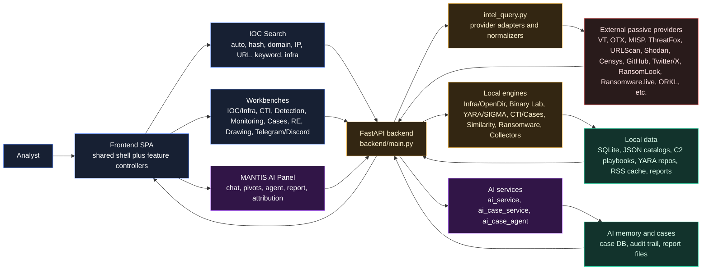
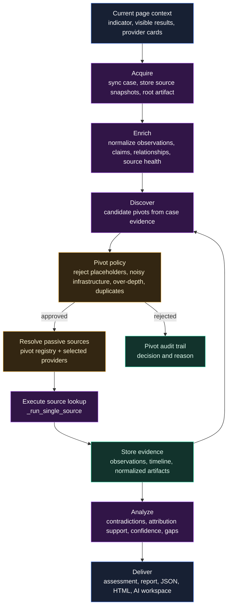

# MANTIS

MANTIS stands for **Multi-source Analysis and Threat Intelligence Search**. **MANTIS** is a threat intelligence workbench for IOC enrichment, OSINT CTI collection, ransomware and breach monitoring, YARA operations, malware similarity analysis, and AI-assisted investigations.

## Highlights

- **IOC and infrastructure intelligence**: Search hashes, domains, IPs, URLs, keywords, and infrastructure; choose providers; pivot from returned evidence; inspect prior lookups; and use dedicated Infra Search, Infra Pivot, OpenDir Hunt, C2 Hunting Catalog, C2 & Tool Exposure, Data Feeds, and Infra History workbenches.
- **MANTIS AI and cases**: Evidence-aware chat, summaries, passive pivot recommendations, bounded agent runs, AEAD case workflows, correlation and attribution assessment, YARA help, Today's Intelligence briefs, reports, and portable AI workspace exports.
- **Threat-intelligence collection**: Today's Intelligence, RSS-backed CTI Articles, Country & Industry Reports, ransomware intelligence, vulnerability/PoC intelligence, OSV malicious packages, threat actors, malware/tool knowledge, and a synchronized Threat Hunting Library.
- **Detection engineering**: Full SIGMA explorer, statistics, emerging-threat and MITRE ATT&CK views, query conversion, repository management, plus YARA exploration, scanning, validation, testing, authoring, and AI-assisted repair.
- **Malware analysis and acquisition**: Similarity families and comparisons, an IDA/Ghidra-backed AI Binary Analysis Lab, a manual Binary Reversing workspace, a local Malware Repository, and VirusTotal bulk sample downloads.
- **Monitoring and underground collection**: X Monitor, Breach Watcher, Credential Stealer ingestion and watchlists, Telegram account/channel and bot workflows, and resumable Discord guild evidence collection.
- **Investigation management**: TI Case Manager for notes, IOCs, samples, relationships, MITRE ATT&CK techniques, references, and MalwareBazaar sample lookup/download.
- **Analyst drawing tools**: Diagram, flowchart, mind-map, map-chart, chart, Mermaid, and Markdown workspaces for turning investigation material into reusable visuals.
- **Dual deployment modes**: Local Workstation mode with native Windows pickers, or authenticated Team Server mode with per-user encrypted API-key vaults, server tool discovery, web uploads, and shared staging areas.

## Open-Source Landscape and Differentiation

MANTIS acknowledges the strong open-source projects that already address important parts of cyber threat intelligence, OSINT, sharing, and enrichment. The comparison below is intended to show differences in product scope rather than make an absolute quality ranking.

**Legend:** ✅ Built-in · ◐ Partial / integration · — Not included

| Project | Primary focus | IOC and OSINT enrichment | CTI knowledge | Continuous monitoring | YARA and malware analysis | Social / Telegram | AI and reporting |
|---|---|---:|---:|---:|---:|---:|---:|
| **[MANTIS](https://github.com/fareedfauzi/MANTIS)** | Unified analyst workbench | ✅ | ✅ | ✅ | ✅ | ✅ | ✅ |
| [IntelOwl](https://github.com/intelowlproject/IntelOwl) | IOC and file enrichment | ✅ | ◐ | ◐ | ✅ | — | ◐ |
| [OpenCTI](https://github.com/OpenCTI-Platform/opencti) | STIX knowledge graph | ◐ | ✅ | ◐ | — | ◐ | ◐ |
| [MISP](https://github.com/MISP/MISP) | Intelligence sharing | ✅ | ✅ | ✅ | ◐ | ◐ | ◐ |
| [YETI](https://github.com/yeti-platform/yeti) | CTI and DFIR enrichment | ✅ | ✅ | ◐ | ◐ | — | — |
| [SpiderFoot](https://github.com/smicallef/spiderfoot) | OSINT and attack-surface mapping | ✅ | ◐ | ◐ | — | ◐ | — |
| [OpenOSINT](https://github.com/OpenOSINT/OpenOSINT) | AI-assisted passive OSINT | ✅ | ◐ | — | — | ◐ | ✅ |
| [Watcher](https://github.com/thalesgroup-cert/Watcher) | AI-powered CTI monitoring | ◐ | ◐ | ✅ | — | — | ✅ |

Based on publicly documented open-source capabilities as of **November 2026**. Integrations and available features may change.

### What MANTIS Adds

- **One investigation surface**: MANTIS combines IOC enrichment, threat knowledge, daily intelligence, ransomware and vulnerability intelligence, breach monitoring, X monitoring, and Telegram collection in one local workspace.
- **Built-in analyst workbenches**: YARA exploration, scanning, authoring, validation and testing; malware similarity; and IDA Pro or Ghidra-backed binary analysis are first-class workflows rather than external handoffs.
- **Evidence-aware AI**: MANTIS AI works over collected provider evidence, supports bounded passive pivots and attribution review, and keeps the underlying source results visible to the analyst.
- **Integrated reporting**: Daily briefs, CTI summaries, case reports, Markdown and JSON exports, saved HTML reports, Binary Lab Markdown/HTML/PDF output, and portable AI workspace bundles are available within the same investigation flow.
- **Local-first analyst experience**: MANTIS is designed as a focused research environment that can be operated locally while still connecting to optional external intelligence providers.

The main differentiator is therefore **workflow consolidation**. IntelOwl provides deeper analyzer orchestration, OpenCTI specializes in structured knowledge graphs, MISP excels at intelligence sharing, YETI focuses on CTI/DFIR enrichment, SpiderFoot and OpenOSINT emphasize OSINT investigation, and Watcher specializes in continuous AI-assisted monitoring. MANTIS brings these normally separated investigation stages together with malware-focused workbenches and evidence-aware reporting.

## Architecture



## MANTIS AI

MANTIS AI is not a generic chatbot bolted onto the UI. It reads compact page context, provider findings, current results, visible text, case state, and analyst-selected evidence. It can then reason about the active investigation while preserving passive/read-only guardrails.

### AI capabilities

- **Assist**: Ask questions about the current result set or investigation page.
- **Summarize Findings**: Convert raw provider cards into concise analyst notes.
- **Recommend Pivots**: Rank passive follow-up actions and suppress noisy pivots.
- **Compare Relationship**: Correlate entities and evidence with overlap/contradiction handling.
- **Attribution**: Score candidate actor/group attribution with evidence categories, contradictions, missing evidence, and confidence bands.
- **Agent Investigation**: Run bounded autonomous next-step selection through approved frontend actions.
- **AEAD Case Run**: Execute Acquire, Enrich, Discover/Pivot, Analyze, and Deliver against case evidence.
- **Report Drafting**: Build case reports, Markdown exports, JSON exports, saved HTML reports, and portable AI workspace ZIPs.
- **YARA Assistant**: Explain rules, analyze validation errors, suggest fixes, auto-fix safe syntax issues, and review test results.
- **CTI AI**: Summarize CTI articles and produce Today's Intelligence AI briefs/reports.
- **Audit and Safety**: Store tool decisions, approval state, operation metadata, and suppressed pivots.

### AEAD workflow



### AI workspace export

**Export AI Workspace** downloads an offline case bundle designed for coding agents and human review. Each ZIP includes `AGENTS.md`, a `CLAUDE.md` pointer, the full normalized `case.json`, focused JSON catalogs, the Markdown report, and portable workflows under `skills/*/SKILL.md` for investigation, evidence review, pivot planning, threat attribution, and report writing. The attribution workflow implements a structured 6-category threat attribution evidence model and adapts its evidence categories and caution rules to MANTIS case data. The export contains no API credentials and its skills prohibit active indicator contact or unsupported enrichment claims.

### Passive pivot registry

The deterministic registry in `backend/ai_pivot_registry.py` maps verified pivot archetypes to existing provider adapters. Current pivot families include:

- Hash pivots: similar samples, network IOCs, YARA matches, family context, behavioral signatures, execution parents.
- Domain pivots: passive DNS, current IPs, certificates, sibling domains, web reputation, threat pulses.
- IP pivots: domains, ASN/BGP, certificates, services/ports, abuse/noise, threat pulses.
- URL pivots: URL telemetry, payload hashes, redirect chains.
- Infrastructure pivots: ASN infrastructure, CIDR exposed hosts, certificate-linked infrastructure.
- Infrastructure Hunt Engine: preview reusable TLS/HTTP/DNS fingerprints before execution; search with Shodan, Censys, FOFA, Netlas, Silent Push, and Driftnet; pivot through Validin and Etugen; validate candidate IPs with GreyNoise; then score, graph, export, and monitor clusters.
- Threat actor pivots: campaigns, infrastructure, ransomware victims.
- Vulnerability pivots: exploits/PoCs and in-the-wild exploitation.
- Malware/social pivots: family samples, social mentions, ThreatFox and MalwareBazaar checks.

## AI Binary Analysis Lab

MANTIS vendors the complete binary analysis engine and exposes it as a first-class web workbench under **Reverse Engineering -> AI Binary Analysis Lab**. The original engine modules and IDAPython runner remain intact; `backend/binary_lab.py` adapts them to persistent MANTIS jobs, progress events, artifacts, settings, and case evidence.

- Discover and queue PE, ELF, Mach-O, IDB/I64, Ghidra projects (GZF/GPR), and managed .NET samples.
- Run native samples through **IDA Pro (headless)** or **Ghidra (headless)** with automatic tool detection and backend selection.
- Rename functions and local variables with address-preserving options.
- Decompile managed assemblies into C#, CIL, metadata, strings, and resources.
- Export AI workspaces with decompiled code, disassembly, headers, catalogs, CFGs, xrefs, globals, imports, strings, and agent instructions.
- Run exported-workspace analysis or in-database autonomous investigation.
- Optionally enrich samples through Triage, VirusTotal, Kaspersky Sandbox, and Kaspersky Similarity, then correlate the external evidence with reverse-engineering findings.
- Generate Markdown, HTML, and PDF reports with token budgets and fallback-provider controls.
- Monitor, stop, resume, delete, inspect, and download jobs, then create MANTIS cases from analyzed hashes.

Install `requirements.txt`, confirm the IDA or Ghidra path under **Engine Settings**, and keep **Use MANTIS AI settings** enabled to reuse the configured MANTIS provider securely. Generated files are stored under `backend/data/binary_lab/output/<job_id>/`; uploaded samples remain under `backend/data/binary_lab/uploads/` until the job is deleted.

## Feature Map

```mermaid
flowchart TB
    classDef ai fill:#311547,stroke:#b76cff,color:#ffffff
    classDef nav fill:#172033,stroke:#5b8cff,color:#ffffff
    classDef src fill:#12332c,stroke:#2bd4a3,color:#dfffee

    Home["MANTIS workbench"]:::nav --> IOC["IOC Intelligence"]:::nav
    IOC --> Search["IOC Search and History"]:::nav
    IOC --> Infra["Infra Search, Pivot, OpenDir, C2 Catalog, Exposure"]:::nav
    IOC --> Feeds["Data Feeds and Infra History"]:::src

    Home --> Intel["Threat Intelligence"]:::nav
    Intel --> Today["Today's Intelligence and CTI Articles"]:::nav
    Intel --> Reports["Ransomware, Country and Industry Reports"]:::nav
    Intel --> Vuln["Vulnerability Intel and Malicious Packages"]:::nav

    Home --> Knowledge["Threat Knowledge and Detection"]:::nav
    Knowledge --> Context["Threat Actors, Malware and Tools, Hunting Library"]:::nav
    Knowledge --> Sigma["SIGMA Explorer, Stats, Emerging, MITRE, Convert, Manager"]:::nav
    Knowledge --> Yara["YARA Explorer, Scanner, Workbench"]:::nav
    Knowledge --> Similarity["Similarity Overview, Families, Compare"]:::nav

    Home --> Monitor["Monitoring and Cases"]:::nav
    Monitor --> Collection["X, Breach, Credential Stealer"]:::nav
    Monitor --> Cases["TI Case Manager"]:::nav

    Home --> Reverse["Reverse Engineering"]:::nav
    Reverse --> Lab["AI Binary Analysis Lab and Binary Reversing"]:::nav
    Reverse --> Samples["Malware Repository and VT Downloader"]:::nav

    Home --> Comms["Telegram and Discord"]:::nav
    Comms --> Telegram["Channel Monitor, Bot Info, Message Dump"]:::nav
    Comms --> Discord["Discord C2 Dump"]:::nav

    Home --> Draw["Drawing and viewers"]:::nav
    Draw --> Visuals["Diagram, Flowchart, Mindmap, Map, Chart, Mermaid, Markdown"]:::nav

    Search --> AI["MANTIS AI"]:::ai
    Infra --> AI
    Intel --> AI
    Cases --> AI
```



## Frontend Navigation

The sidebar is the analyst's main workflow map. Each item opens a focused workbench while keeping pivots, history, settings, and MANTIS AI close to the current evidence.

The current source-backed navigation inventory is:

| Area | Implemented workbenches |
| --- | --- |
| IOC Intelligence | IOC Search, IOC Lookup History, Infra Search, Infra Pivot, OpenDir Hunt, C2 Hunting Catalog, C2 & Tool Exposure, Data Feeds, Infra History |
| Threat Intelligence | Today's Intelligence, Ransomware Intelligence, CTI Articles, Country & Industry Reports, Vulnerability Intel, Malicious Packages |
| Threat Knowledge | Threat Actor, Malware & Tools, Threat Hunting Library, SIGMA, YARA, Similarity |
| Monitor and Cases | X Monitor, Breach Watcher, Credential Stealer, TI Case Manager |
| Drawing | Diagram, Flow Chart, Mindmap, Map Chart, Chart Creator, Mermaid Viewer, Markdown Viewer |
| Reverse Engineering | AI Binary Analysis Lab, Binary Reversing, Malware Repository, VT Samples Downloader |
| Telegram and Discord | Telegram channel monitor, Bot Info, Dump Messages, Discord C2 Dump |
| Settings | API Keys, GitHub Repos, MANTIS AI, Deployment Mode, Analysis Tools, and Users & Team in server mode |

### Home


The Home page is the entry point to MANTIS. From here, **Click to Enter** opens IOC Search and starts the main investigation workflow.

Returning Home also closes the active workspace and brings the interface back to its initial state.

### IOC Search


IOC Search is where most investigations start. It accepts **hashes, domains, IP addresses, URLs, keywords, and infrastructure queries**, with Auto-Detect available when the indicator type is not specified.

Before running a lookup, analysts can choose which intelligence providers to query. MANTIS collects the results and presents them as provider-specific cards rather than mixing everything into a single verdict.

Depending on the indicator and available sources, results may include reputation, detections, MISP event context, passive DNS, certificates, related infrastructure, malware families, sandbox observations, sightings, and other provider context. Values returned by providers can also be used as pivots for follow-up searches inside MANTIS.

### History Lookups


History Lookups keeps a local record of previous MANTIS searches. It is useful when returning to an IOC investigated earlier or checking what information was available during a previous lookup.

The same section also contains **AI Reports**, where reports generated by MANTIS AI can be reopened or removed.

### Infrastructure research workbenches

Infrastructure research is split into focused views rather than one overloaded screen:

- **Infra Search** runs provider-backed infrastructure queries from IOC Search.
- **Infra Pivot** normalizes seed material or extracted text, runs selected passive capabilities, tracks investigations, renders evidence and an interactive relationship graph, and supports cancel, resume, history, and export.
- **OpenDir Hunt** inventories observed open directories and files, applies scoring, stores snapshots and changes, manages collection jobs, and supports watchlists.
- **C2 Hunting Catalog** manages reusable provider queries and C2 framework playbooks.
- **C2 & Tool Exposure** executes editable passive queries for curated C2, phishing, malware, security-tool, and AI red-team profiles and stores observations for later IOC searches.
- **Data Feeds** synchronizes the feed catalog, enables or disables sources, refreshes Kaspersky feeds, and exports the active catalog.
- **Infra History** reopens saved infrastructure investigations and run output.

### Today's Intelligence

Today's Intelligence provides a consolidated view of recent security activity collected by MANTIS.


The page brings together **CTI articles, exploited vulnerabilities, newly published PoCs, ransomware activity, regional signals, and social intelligence**. Results can be filtered by source, severity, country, ransomware group, and collection period.

For a faster review, MANTIS AI can summarize the collected items into a daily brief or generate a more structured intelligence report.

### Threat Actor


Threat Actor provides a searchable reference for known threat actors and activity clusters.

The dataset currently includes information from **MISP, Microsoft Activity Groups, Tidal, surveillance-vendor datasets, and Kaspersky TIP**. Profiles may contain aliases, descriptions, references, associated malware or tools, and other names that can be pivoted back into MANTIS searches.

This view is mainly intended for attribution research and for adding actor context while investigating a campaign.

### Malware & Tools


Malware & Tools is a searchable reference for malware families and tooling seen in threat activity.

Entries are grouped into categories such as **RATs, ransomware, botnets, Android malware, RMM tools, stalkerware, exploit kits, cryptominers, and TDS**, with additional data from MISP Galaxy and Malpedia.

An entry can be used as a starting point for further research into related reports, indicators, samples, YARA rules, and infrastructure.

### Ransomware Monitor


Ransomware Monitor tracks ransomware and extortion activity from several public intelligence sources.

It covers **recent victims, ransomware groups, activity trends, affected countries and sectors, ransom notes, cryptocurrency addresses, infrastructure, detection IOCs, and watchlist matches**.

Data is collected from sources including **RansomLook, Ransomware.live, and ThreatLabz ransomware notes**, then exposed through a common interface for monitoring and investigation.

### YARA


The YARA section provides three separate workflows:

- **Rule Explorer** — search and browse rules from local and synchronized YARA repositories.
- **Sample Scanner** — scan a sample against selected rule collections.
- **Rule Workbench** — write, validate, test, and save YARA rules.

The workbench supports individual files, paths, uploaded samples, and local corpora for testing. MANTIS AI can also explain existing rules, inspect validation errors, and suggest fixes while developing a rule.

### Similarity


Similarity is used to compare malware samples against previously defined malware or threat-actor entities.

Analysts can create entities, attach reference samples, extract static features, and compare new samples against the stored dataset. Features can include **strings, imports/APIs, functions, basic blocks, and other static characteristics**, with optional IDA/Hex-Rays-derived data when available.

The goal is not to automatically attribute a sample. The comparison exposes shared characteristics and similarity evidence that can support manual malware clustering and attribution analysis.

### AI Binary Analysis Lab


The **AI Binary Analysis Lab** provides an integrated reverse-engineering workbench within MANTIS. It supports native binaries (PE, ELF, Mach-O), disassembler databases (IDA `.idb`/`.i64`, Ghidra `.gzf`/`.gpr`), and managed .NET assemblies (`EXE`/`DLL`).

- **Dual Disassembler Backends**: Runs native binaries through headless **IDA Pro** (`idat64`) or headless **Ghidra** (`analyzeHeadless`) with automatic engine detection and backend selection under Engine Settings.
- **Go and .NET Support**: Integrated **GoReSym** restores stripped Go function names, package paths, and types; **ILSpy** (`ilspycmd`) decompiles .NET assemblies into clean C# source trees, metadata, and resources.
- **AI Semantic Renaming**: Renames functions and local variables into meaningful descriptive identifiers while preserving original virtual addresses for easy disassembler correlation.
- **Autonomous Investigation**: Optional multi-pass autonomous analysis loop investigates capabilities (persistence, anti-analysis, C2 beacons, credential dumping) and traces data flow between functions.
- **Optional Sandbox Intelligence**: With separately configured keys, submit samples to Triage or Kaspersky Sandbox, check or explicitly submit to VirusTotal, request Kaspersky similarity, preserve raw evidence, and generate a correlated AI report. These options are off by default and send a hash or sample to an external service.
- **AI Workspace Bundle**: Generates offline workspaces containing decompiled code, CFGs, linear disassembly, structured JSON catalogs (functions, variables, strings, imports, exports), and agent instruction prompts (`AGENTS.md`).
- **Multi-Format Reporting**: Generates interactive HTML, Markdown, and downloadable PDF reports with executive summaries, MITRE ATT&CK taxonomy mapping, and YARA signature recommendations.
- **Job Navigation**: Multi-tab job inspector features `Queue`, `Analysis`, `Functions`, `Variables`, live streaming `Disassembler Log` (with noise filtering and auto-scroll), `Reports`, `Events`, and an interactive `Artifacts` tree.
- **CTI Case Handoff**: A single click on **Create Case** bridges the analyzed sample's cryptographic hashes and extracted network IOCs directly into a MANTIS CTI Case for external intelligence enrichment.

Detailed guide: [AI Binary Analysis Lab Documentation](docs/ai_binary_lab.md).

### Binary Reversing and Malware Repository

**Binary Reversing** opens a completed Binary Lab extraction as a manual reversing workspace. Analysts can browse samples, functions, strings, imports, and extracted code, copy addresses, and attach function notes. A new binary can also be submitted for extraction before the workspace opens.

**Malware Repository** is the local sample store. It supports multi-file upload, search and filtering, editable metadata and tags, sample details, deletion, password-protected ZIP download, and one-click staging into Binary Lab. Files remain local to the MANTIS backend.

### Infrastructure Hunt


The **Infrastructure Hunt Engine** enables proactive adversary infrastructure tracking, C2 discovery, and network asset correlation:

- **Hunter Deck Feature Extraction**: Ingests seed indicators (IP, domain, ASN, CIDR, or certificate SHA-256) and extracts high-fidelity fingerprints including JA4/JA4X, JARM, SSL/TLS certificate attributes, HTTP server banners, Favicon MurmurHash3 (MMH3), HTML `<title>` tags, and open port profiles.
- **Shared Infrastructure Suppression**: Automatically filters multi-tenant CDN/Cloud edge proxies (Cloudflare, Akamai, Fastly, AWS CloudFront, Azure Front Door) to avoid false-positive cluster expansion.
- **Curated C2 Hunting Playbook Catalog**: Ingests over 1,000 proven hunting queries for major C2 frameworks (**Cobalt Strike**, **Sliver**, **Havoc**, **Metasploit**, **Mythic**, **PoshC2**, **Brute Ratel**, **ShadowPad**, **AsyncRAT**, **Redline Stealer**) across Shodan, Censys, FOFA, Netlas, URLScan, and Etugen.
- **Multi-Engine Correlation & Preview**: Generates composite multi-signal queries and executes parallel searches across configured engines.
- **Scoring & GreyNoise Verification**: Evaluates candidate infrastructure nodes with multi-signal corroboration scoring (High, Medium, Low confidence) and verifies IPs against GreyNoise to filter out benign internet scanners.
- **Interactive Graph & Monitor**: Visualizes the seed-to-signal-to-infrastructure graph, exports candidates to CSV/JSON, and saves persistent hunts in `backend/data/infra_hunts.db` for automated scheduled monitoring and infrastructure drift alerts.
- **C2 Hunting Catalog**: Search and filter by engine and category, including AI Red Team console, certificate, and favicon pivots across Shodan, FOFA, Censys, ZoomEye, Netlas, and urlscan. Copy or open a query, and add, edit, or delete queries in the editor. Built-in changes and custom queries persist in `backend/data/c2_query_edits.db` across source catalog rebuilds.
- **C2 & Attack Tool Exposure**: Check 40 curated C2, phishing, malware, security-tool, and AI Red Team profiles against configured Shodan, FOFA, Censys, ZoomEye, and Validin searches. The twelve AI Red Team profiles cover ARTEX, CyberStrikeAI, CyberStrike, PentAGI, Strix, ScopeWeaver, Agent Zero, RedAmon, Cairn, Xalgorix, Decepticon, and redcell. CLI-only frameworks without a defensible passive internet fingerprint are excluded from Exposure. The Shodan-led expansion draws from the local hunting catalog, favoring specific panel, certificate, product, and content signals; favicon matches need corroboration. View, copy, add, edit, or delete the exact provider queries from each profile. The default Shodan check saves one page of up to 100 matches per query and displays Shodan's reported total separately; the evidence view can explicitly retrieve up to ten pages per query (additional pages consume Shodan query credits). On-demand checks save host observations in `backend/data/exposure_monitor.db`; historical IP and domain leads appear as a local source in IOC Search. Matches are indexed leads, not proof of malicious operation or live C2 totals.

Detailed guide: [Infrastructure Hunting Guide](docs/infrastructure-hunting.md).

### VirusTotal Bulk Samples Downloader


The **Samples Downloader** provides high-throughput malware sample acquisition directly from VirusTotal by cryptographic hash:

- **Batch Ingestion**: Accepts up to **50 hashes per execution** (MD5, SHA-1, SHA-256) separated by spaces, commas, semicolons, or newlines.
- **Dual Download Modes**:
  - **Direct to Local Folder**: Uses the modern browser File System Access API (`showDirectoryPicker()`) to stream binaries directly into a chosen folder on disk as `<hash>.bin`, bypassing browser RAM buffering.
  - **Encrypted ZIP Archive**: Packages acquired samples into an AES-256 encrypted archive (`vt_samples_<timestamp>.zip`) with standard security password `infected` to prevent accidental execution.
- **Live Diagnostics & Feedback**: Real-time progress bar, summary counters, and explicit diagnostic error reporting (e.g., 404 Not Found, 401/403 Forbidden, 429 Quota Exceeded, 504 Timeout).
- **Clipboard Helpers**: One-click **Copy Failed** and **Copy Success** buttons for rapid re-querying or incident documentation.
- **Safety Consent Guardrail**: Requires mandatory analyst confirmation before initiating downloads to prevent accidental handling of live malware on non-sandbox workstations.
- **Workflow Integration**: Integrates directly with **VT Monitoring** via one-click "Send to Downloader" buttons, and allows immediate sample handoff into the **AI Binary Analysis Lab**.

Detailed guide: [VirusTotal Bulk Samples Downloader Guide](docs/vt_bulk_downloader.md).

### VirusTotal threat monitoring

The VirusTotal integration also includes Livehunt and Retrohunt controls. Analysts can create, edit, enable, disable, and delete Livehunt YARA rulesets; review and delete match notifications; open matched-file details; send matched hashes to the Samples Downloader; create or abort Retrohunt jobs; and inspect job matches. Availability and quotas depend on the configured VirusTotal account.

### CTI Articles


CTI Articles is MANTIS's local library of threat-intelligence reporting.

Configured RSS feeds are periodically collected and stored locally together with article metadata and extracted indicators. Analysts can search the archive, filter by source or category, enable or disable feeds, and manually trigger feed synchronization.

Articles can be opened directly inside MANTIS, and MANTIS AI can summarize longer reports into shorter investigation notes.

### Country & Industry Reports

Country & Industry Reports builds report indexes from locally collected CTI articles. It groups tagged articles by country or industry, opens the supporting article set, and can generate a focused brief. When configured, AI-assisted tagging processes untagged articles in batches.

### Vulnerability Intelligence


Vulnerability Intelligence focuses on the information around a vulnerability rather than just the CVE record.

It combines **PoC availability, trending exploit repositories, CISA KEV data, severity information, references, and OSV malicious-package intelligence**.

This makes it easier to answer practical triage questions such as whether public exploit code exists, whether exploitation has been observed, and what technical references are available for further analysis.

### X Monitor


X Monitor follows selected security researchers, threat-intelligence accounts, and other monitored X/Twitter sources.

Accounts can be added, edited, removed, categorized, and refreshed from the interface. Collected posts can then be reviewed for indicators and investigation context.

The monitor is mainly used to catch information that often appears on social media before it reaches a formal CTI report: **new vulnerabilities, PoCs, malware campaigns, infrastructure, threat-actor activity, and researcher findings**.

### Breach Watcher


Breach Watcher collects information about publicly reported breaches, leaks, and credential exposure.

It combines breach feeds with **RecentBreaches, DataBreach.watch, Have I Been Pwned breach metadata, Infostealers Stats, and Leak-Lookup**. Depending on the source, analysts can review breach names, affected domains, dates, exposed data types, and other available metadata.

Search functions are also available for supported identifiers such as domains, email addresses, usernames, and IP addresses.

### Credential Stealer

Credential Stealer ingests stealer-log folders and uploaded archives, or synchronizes configured Telegram channels. It provides overview statistics, searchable credential records, source-level controls, batch deletion and export, a corporate asset watchlist, and ingestion/harvester job tracking. An unrecognized-file queue and AI-assisted parser studio let analysts test and save custom parsers without changing the built-in parser set.

### TI Case Manager

TI Case Manager stores investigation cases with status, severity, notes, indicators, malware samples, MITRE ATT&CK techniques, references, and relationships to other cases. Indicators are shared records with case-specific notes and can be sent back to IOC Search. Cases can import IOCs, attach local or MalwareBazaar samples, and download available samples as password-protected archives.

### Telegram Toolkit


Telegram Toolkit provides several utilities for collecting and reviewing threat intelligence from Telegram.

**Channel Monitor** uses an authenticated MTProto session to follow configured channels, including sources related to threat actors, hacktivism, ransomware leaks, stealer logs, malware distribution, and CTI.

**Telegram Auth Settings** manages the MTProto session used by the monitor.

**Bot Info** retrieves available information about a Telegram bot from a supplied bot token.

**Dump Messages** collects messages available to a bot and exposes the returned messages and artifacts for analysis.

**Discord C2 Dump** validates a recovered bot token and guild, inventories channels (including voice and categories), active and archived threads, roles and emojis, and collects all accessible message history and paginated pins. It downloads attachments up to a configurable per-file limit (25 MB by default), hashes local copies and indexes small text files for search. Collection runs in a background job with per-channel status, cancellation and cursor-based resumption after failures. Messages, names, attachment metadata and job status reside in `backend/data/discord_c2_dump.db`; downloaded files reside in `backend/data/discord_c2_attachments/`. Bot tokens are held only in memory for an active request and must be entered again for resumption. Coverage depends on the bot's permissions and Message Content Intent. The interface reports inaccessible scopes and download errors.

Where applicable, collected content can be parsed for **IOCs, credentials, archives, victim or target references, and other Telegram artifacts**.

### Threat Hunting Library

The **Threat Hunting Library** collects original queries from configured public GitHub repositories. It indexes supported native query files and identifiable queries in Markdown, YAML, JSON and TOML. Identical query text is stored once with every source reference preserved. The library supports search, facets, repository management, synchronization history, and AI-assisted native query conversion through the existing Query Converter. Source metadata is shown separately from inferred platform, category and telemetry labels.

The five initial repositories synchronize automatically on startup and daily; manual sync is available from the UI. Synchronization uses Git's public HEAD check and streamed repository ZIP archives, without the GitHub API or a token. Unchanged revisions skip the archive download; changed files are identified and indexed by local hashes. Download and indexing stages appear in the shared progress view. Previous indexed data remains available if an archive fails. Repository license information is read from license files when recognizable; original source URLs are preserved. AI conversion requires a configured MANTIS AI provider.

### SIGMA

The SIGMA workspace includes **Rules Explorer**, **Rules Stats**, **Emerging Threats**, **MITRE ATT&CK**, **Convert to Query**, and **Manager**. It searches and validates synchronized rules, maps rules to ATT&CK and emerging CVE context, converts rules through pySigma or an optional AI repair/conversion path, synchronizes repositories, manages custom sources and rules, clones rules, and exports custom content.

### Drawing and report-building tools

The drawing area contains a template-backed cyber diagram editor, flowchart and mind-map editors, a geographic map chart, a data chart creator with CSV/TSV import, and Mermaid and Markdown viewers. These tools run in the browser and are intended for investigation notes, reporting, and presentation-ready visual output.

### MANTIS AI


MANTIS AI works on top of the intelligence already collected during an investigation.

Instead of treating the AI panel as a standalone chatbot, MANTIS passes the current investigation context and available source evidence to the model. It can summarize findings, identify relationships, suggest useful passive pivots, review attribution evidence, and generate investigation reports.

For agent-based investigations, the model can also decide which available passive sources are worth querying next and continue the investigation within defined limits.

The analyst still gets the underlying provider results, so AI output can be checked against the evidence it was derived from.


### Settings

Settings centralizes operational configuration. **API Keys** manages provider credentials, **GitHub Repos** stores repositories used by GitHub threat-intelligence searches, and **MANTIS AI** configures provider/model/timeout and connectivity. **Analysis Tools** manages supported reverse-engineering dependencies. Team Server administrators also receive **Deployment Mode** and **Users & Team** controls. Feed catalog controls live in the separate **Data Feeds** workbench.


## Backend Modules

| Module | Purpose |
| --- | --- |
| `backend/main.py` | FastAPI app, route registration, startup tasks, static frontend serving. |
| `backend/intel_query.py` | IOC provider adapters, source metadata, normalization, lazy provider helpers. |
| `backend/ai_service.py` | AI settings, chat, summaries, pivots, agent runs, audit, attribution/correlation wrappers, YARA AI wrappers. |
| `backend/ai_case_service.py` | AI case DB, evidence extraction, source execution, AEAD run, reports, exports, related cases. |
| `backend/ai_case_agent.py` | Case hypothesis analysis and next-step planning. |
| `backend/ai_pivot_registry.py` | Passive pivot archetype registry. |
| `backend/ai_pivot_policy.py` | Pivot validation, duplicate/noise rejection, safety bounds. |
| `backend/ai_source_router.py` | Source inventory, source priority, source role, next-source planning. |
| `backend/ai_correlation.py` | Entity feature extraction, overlap evidence, contradiction handling, relationship classification. |
| `backend/ai_attribution.py` | Candidate normalization, evidence scoring, contradiction severity, confidence bands. |
| `backend/ai_yara_assistant.py` | YARA parsing, explain, error analysis, safe fix suggestions, auto-fix validation. |
| `backend/yara_*.py` | YARA repo discovery, engine compilation, scanning, workbench validation/save/test support. |
| `backend/sample_similarity/` | Sample similarity: families, multi-format extraction (PE/ELF/Mach-O/.NET/Go/PyInstaller), scoring and routes. |
| `backend/binary_lab.py` | Binary Lab job adapter, dual IDA/Ghidra headless dispatch, GoReSym, ILSpy, progress events, artifacts, and case bridge. |
| `backend/infra_hunt_service.py` | Infrastructure hunt engine, seed feature extraction, candidate correlation/scoring, graph generation, persistent hunts. |
| `backend/infra_pivoting_service.py` | Capability registry, text extraction, evidence normalization, attribution, investigation lifecycle, graph data, and exports for Infra Pivot. |
| `backend/c2_hunting_catalog.py` | Curated C2 framework hunting playbook catalog and multi-engine query generator. |
| `backend/exposure_monitor.py` | Passive C2/tool exposure profiles, editable queries, provider execution, and saved observations. |
| `backend/opendir_hunt.py` and `backend/opendir_routes.py` | Open-directory collection, file inventory, scoring, snapshots, change tracking, jobs, and watchlists. |
| `backend/omni_idb/` | Binary analysis engine modules. |
| `backend/omni_runtime/scripts/` | Vendored IDAPython, authentication, workspace, and report scripts. |
| `backend/malware_db.py` | Local malware sample storage, metadata, staging, deletion, and encrypted download archives. |
| `backend/ti_cases.py` and `backend/ti_cases_routes.py` | TI case, IOC, sample, relation, note, and MalwareBazaar workflows. |
| `backend/credential_stealer.py` | Stealer-log ingestion, credential records, watchlists, Telegram/local sources, jobs, and custom parsers. |
| `backend/discord_c2_dump.py` and `backend/discord_c2_routes.py` | Discord guild inspection, resumable evidence collection, message search, attachments, and job state. |
| `backend/sigma_*.py` | SIGMA repository sync, rule validation/search, statistics, ATT&CK/emerging views, conversion, and custom-rule management. |
| `backend/threat_hunting_library.py` and `backend/threat_hunting_library_routes.py` | Public repository sync, query extraction/deduplication, search facets, history, and conversion. |
| `backend/intel_reports.py` | Country/industry article tagging, indexes, detail views, and brief generation. |
| `backend/todays_intelligence.py` | Daily intelligence aggregation and health/source rollups. |
| `backend/ransomware_monitor.py` | Ransomware victim/group/trend/region/note/crypto aggregation and watchlist. |
| `backend/cti_*.py` | CTI feed configuration, collection, extraction, DB access, and query helpers. |
| `backend/tg_*.py` | Telegram bot investigation, MTProto auth, channel monitor, stealer log parsing, exposure matching. |
| `backend/x_monitor.py` | X/Twitter account monitor and post categorization. |
| `backend/breach_watcher.py` | Breach RSS, HIBP, Infostealers Stats, and Leak-Lookup integration. |
| `backend/pocindex_mod.py` | CVE/PoC/KEV/OSV vulnerability intelligence helpers. |

## API Surface

The backend exposes these main API families:

- `/api/query/{hash,domain,ip,url,keyword,infra}`: Core IOC lookups.
- `/api/meta/*`: Source metadata, startup status, tags, malware names.
- `/api/ai/*`: AI settings, chat, tools, audit, agent, cases, reports, correlation, attribution, YARA AI, Today's Intelligence AI.
- `/api/infra-hunts/*`: Infrastructure hunt preview, execution, C2 playbooks, Etugen templates, provider readiness, persistent hunts CRUD, run history, signature packs, run-due.
- `/api/infra-pivoting/*`: Capabilities, normalization, text extraction, attribution, runs, saved investigations, cancel/resume, raw evidence, and exports.
- `/api/opendir/*` and `/api/exposure-monitor/*`: Open-directory jobs/inventory/watchlists and passive C2/tool exposure queries/results.
- `/api/binary-lab/*`: Engine status, settings, tool file selection, job management (upload/path), cancel/resume/delete, catalogs, disassembler logs, artifacts, ZIP export, CTI case bridge.
- `/api/binary-reversing/*` and `/api/malware-db/*`: Manual reversing data/notes and the local malware sample repository.
- `/api/vt/download` and `/api/vt/download/zip`: Single binary stream and AES-encrypted ZIP batch sample downloads.
- `/api/vt/hunting/*` and `/api/vt/retrohunt/*`: Livehunt status/rulesets/notifications and Retrohunt job lifecycle/matches.
- `/api/misp-galaxy/*` and `/api/ktip/*`: Threat actor, malware/tool, and Kaspersky TIP knowledge.
- `/api/yara/*`: Rule search, rule source, scan, validate, workbench save, corpus tests, upload/path tests.
- `/api/sigma/*`: Repositories, rules, statistics, emerging threats, ATT&CK mapping, validation, conversion, templates, custom sources, cloning, and export.
- `/api/similarity/*`: Dashboard, entities, samples, compare, progress, settings, IDA path selection.
- `/api/cti/*`: Articles, search, article detail, AI summary, source/category CRUD, sync.
- `/api/intel-reports/*` and `/api/todays-intelligence*`: Country/industry report indexes and briefs, daily rollups, AI briefs, and AI reports.
- `/api/poc/*` and `/api/osv/*`: PoC/KEV stats, trends, search, OSV recent/query/package data.
- `/api/ransomware-monitor/*`, `/api/rwlive/*`, `/api/ransomlook-*`: Ransomware activity and provider-specific details.
- `/api/tg/*`: Telegram bots, messages, discovery, artifacts, stream, channel monitoring, targets, exposure stats.
- `/api/discord-c2/*`: Guild inspection, background collection, messages, jobs, cancellation, channels, names, and downloaded attachments.
- `/api/x-monitor/*`: X/Twitter monitor dashboard, accounts, refresh.
- `/api/breach-watcher/*`: Breach feed, HIBP, Leak-Lookup, stats.
- `/api/credential-stealer/*`: Sources, uploads, credentials, exports, watchlists, jobs, parsers, unrecognized files, and sync controls.
- `/api/ti/*`: Cases, shared IOCs, case notes/relations, attached samples, and MalwareBazaar lookups/downloads.
- `/api/hunting-library/*`: Repository management/sync, query search, platform facets, history, and conversion.
- `/api/feeds/*`: Threat feed catalog and source toggles.
- `/api/auth/*`, `/api/user/keys*`, `/api/config/deployment*`, and `/api/staging/*`: Team authentication, user administration, encrypted per-user keys, deployment mode, and shared staging.

## Intelligence Sources

MANTIS mixes built-in local datasets, keyless public lookups, and optional API-backed providers. Configure keys in **Settings -> API Keys** or environment variables where supported.

The bundled Malpedia YARA Signator rules are by Felix Bilstein and distributed under
[CC BY-SA 4.0](https://creativecommons.org/licenses/by-sa/4.0/).
[Upstream rules](https://github.com/malpedia/signator-rules).
The bundled YARAify rules retain their original authors and per-rule license notices.
[YARAify licensing and sharing](https://yaraify.abuse.ch/faq/).

### Free or local sources

- CTI Articles local corpus
- MISP Galaxy and local galaxy JSON
- YARA local rules, YARA Forge, Elastic YARA
- crt.sh certificate transparency
- RIPEstat
- SANS ISC
- OpenPhish and PhishStats
- ThreatMiner
- ORKL CTI
- Malware.News
- RansomLook.io
- ThreatLabz ransomware notes
- Common Crawl and Internet Archive/Wayback lookups
- Telegram local databases
- X Monitor local cache
- Breach RSS sources
- PoC/KEV/OSV local indexes

### Optional API-backed sources

- VirusTotal
- Abuse.ch: ThreatFox, MalwareBazaar, URLhaus, YARAify
- AlienVault OTX
- AbuseIPDB
- URLScan.io
- Hatching Triage
- Hybrid Analysis
- MalShare
- Kaspersky TIP
- CyberBriefing
- Shodan
- Censys
- Silent Push
- Driftnet
- Validin
- Pulsedive
- FOFA
- DNSDumpster
- GreyNoise
- LeakIX
- ThreatBook
- Ransomware.live PRO
- GitHub
- Twitter/X via TwitterAPI.io
- RecentBreaches
- DataBreach.watch
- Leak-Lookup

## Setup

### Requirements

- Python 3.10 or newer is recommended.
- A modern browser.
- Optional native dependencies for some features:
  - `ssdeep` requires libfuzzy headers and is not installed by default.
  - IDA/Hex-Rays is optional for richer similarity extraction.
  - Telegram MTProto monitoring requires Telegram API credentials.

### Windows

```cmd
run.bat
```

`run.bat` uses **Workstation Mode** by default. Use `--reconfigure` when you want the interactive mode prompt, or pass `--server` / `--workstation` directly. The selected mode is saved to `.env`.

By default, `run.bat` starts FastAPI at:

```text
http://127.0.0.1:9999
```

You can override the port or deployment mode directly:

```cmd
set MANTIS_PORT=8000
run.bat --server          # Launch in Team Server mode
run.bat --workstation     # Launch in Workstation mode
run.bat --reconfigure     # Re-run first-time setup prompt
```

Useful launch flags and environment variables:

- `--server` / `-s`: Force Team Server deployment mode.
- `--workstation` / `-w`: Force Local Workstation mode.
- `--reconfigure` / `--setup`: Re-prompt for deployment mode.
- `MANTIS_MODE=workstation|server`: Set deployment mode in `.env` or shell.
- `MANTIS_SKIP_DEPS=1`: Skip dependency checks.
- `MANTIS_FORCE_DEPS=1`: Force `pip install -r requirements.txt`.
- `MANTIS_RELOAD=1`: Start Uvicorn with reload for development.
- `MANTIS_YARA_STARTUP_BUILD=1`: Build YARA repos during backend startup.

For a Windows team server, use `run.bat --server`. There are no separate Windows Server launcher or authentication-test scripts in the current repository.

### Linux

```bash
chmod +x start_linux.sh
./start_linux.sh
```

You can pass `--server` or `--workstation` directly:

```bash
./start_linux.sh --server
```

The Linux script creates/uses `backend/venv`, installs dependencies, prompts for deployment mode on an interactive first run, and starts the backend service. A non-interactive first run defaults to server mode. `MANTIS_HOST` and `MANTIS_PORT` can override the mode-specific defaults.

### Manual development run

```bash
pip install -r requirements.txt
python -m uvicorn main:app --app-dir backend --host 127.0.0.1 --port 9999
```

---

## Deployment Modes (Workstation vs. Team Server)

MANTIS features a dual-mode engine designed to seamlessly support both standalone analyst workstations and multi-user internal team servers:

| Capability / Behavior | **Workstation Mode** (Default) | **Team Server Mode** |
| :--- | :--- | :--- |
| **Primary Environment** | Personal analyst laptop or desktop | Shared team server (Linux or Windows VM) |
| **Network Interface** | Linux defaults to `127.0.0.1`; the current Windows launcher binds Uvicorn to `0.0.0.0` and opens `127.0.0.1` locally | Defaults to `0.0.0.0` for team access |
| **Host File Pickers** | Native Windows file & folder dialogs active | Native dialogs disabled to prevent server deadlocks |
| **Reverse Engineering Tools** | Analyst inputs path or browses locally | Server auto-detects from `backend/data/tools/` or `PATH` |
| **Malware Samples Input** | Local file browsing or web drag-and-drop | Web drag-and-drop or `data/staging/samples/` dropdown |
| **Stealer Logs Input** | Local folder browsing | Shared drop zone in `data/staging/stealer_logs/` |
| **Browser Behavior** | Automatically launches local browser | Headless server; displays access URL |

### Server Directory Structure & Drop Zones

When set up in **Team Server Mode**, MANTIS provisions a standardized server directory tree under `backend/data/`:

```text
backend/data/
|-- tools/                        # Pre-installed binaries & decompilers (Auto-discovered)
|   |-- ida/                      # Place idat64 / ida64 / idal64 here
|   |-- ghidra/                   # Place Ghidra root or analyzeHeadless here
|   |-- goresym/                  # Place GoReSym executable here
|   `-- ilspycmd/                 # Place ilspycmd executable here
|-- staging/                      # Shared team drop zones (Mounted via SFTP / SMB)
|   |-- samples/                  # Drop malware binaries here (auto-listed in Binary Lab)
|   `-- stealer_logs/             # Drop logs & combos (.zip, folders) here (auto-listed in Credential Stealer)
`-- workspace/                    # Sandboxed per-job analysis outputs
```

### Multi-User Authentication & Personal API Key Vaults

In **Team Server Mode**, MANTIS enforces multi-user access with private, encrypted per-analyst API key vaults:

- **Authentication & Roles**:
  - Secure login with PBKDF2-HMAC password hashing and signed session tokens.
  - **Admin**: Full access, user account provisioning, server deployment configuration.
  - **Analyst**: Full investigation workbench, IOC enrichment, and personal key vault.
  - **Zero Default Password**: On every server startup, MANTIS autogenerates a fresh secure random administrator password and prints it clearly in the terminal console.
  - **Admin Password Reset**:
    - **In Web UI**: Open **Settings &rarr; Team Management** and click **Change My Password** (persists to `.env` so restarts honor it).
    - **From Terminal / CLI**: Run `python backend/auth_service.py --reset-admin [new_password]` anytime from the server shell.
    - **Environment / `.env`**: Set `MANTIS_ADMIN_PASSWORD=your_custom_password` (min 8 characters).
- **Personal Encrypted Key Vault**:
  - Each analyst configures their own API keys (VirusTotal, Shodan, Censys, OpenAI, etc.) in **Settings &rarr; API Keys**.
  - Keys are encrypted at rest with **AES-256-GCM** using a persistent server secret (`MANTIS_SECRET_KEY`).
  - Analysts cannot view, access, or burn each other's quota.
- **Zero Friction for Workstations**:
  - In **Workstation Mode**, authentication is automatically bypassed with a local analyst profile, preserving the seamless local PC experience.

### Deployment controls in the web UI

In Team Server mode, administrators can open **Settings -> Deployment Mode** to inspect server directories, staging counts, tool discovery, and the active mode. For initial selection or a workstation-to-server change, use the launcher flags (`--server`, `--workstation`, or `--reconfigure`) or set `MANTIS_MODE` before startup.

## Configuration

Most analyst-facing settings are available in the web UI:

- **API Keys**: Provider credentials; in Team Server mode these are stored in each analyst's encrypted vault.
- **GitHub Repos**: Repository list used by GitHub threat-intelligence searches.
- **MANTIS AI**: Provider, model, timeout, executable/SSO options, and connectivity test.
- **Deployment Mode**: Server-admin view of the current mode, server directories, staging counts, and reverse-engineering tool discovery.
- **Analysis Tools**: Installation or location controls for supported Binary Lab dependencies.
- **Users & Team**: Server-mode user administration and password management.
- **Data Feeds**: Catalog sync, source toggles, Kaspersky refresh, status, and export from the main sidebar.

Server-side environment variables are also supported for many providers, including `GITHUB_TOKEN`, `GITHUB_API_TOKEN`, `RANSOMWARE_LIVE_API_KEY`, `SHODAN_API_KEY`, `CENSYS_PAT`, `CENSYS_API_KEY`, `DRIFTNET_API_TOKEN`, `SILENT_PUSH_API_KEY`, `VALIDIN_API_KEY`, `ETUGEN_API_KEY`, `GREYNOISE_API_KEY`, `NETLAS_API_KEY`, `ZOOMEYE_API_KEY`, `PULSEDIVE_API_KEY`, and related `MANTIS_*` or `IOCINTEL_*` variants used by `intel_query.py`.

## Data And Generated Artifacts

MANTIS writes runtime data under `backend/data/`, including local databases, downloaded YARA rules, CTI feed data, PoC indexes, Telegram intelligence, temporary acquisition files, and generated AI reports.

Important generated paths:

- `backend/data/reports/`: Saved AI HTML reports.
- `backend/data/temp/`: Temporary acquisition/export helpers.
- `backend/data/yara-rules/`: Local and synced YARA rule sets.
- `backend/data/sigma-rules/`: Local and synchronized SIGMA rules.
- `backend/data/misp/`: MISP Galaxy data.
- `backend/data/pocindex/`: Vulnerability intelligence cache.
- `backend/data/binary_lab/`: Binary Lab uploads, output, workspaces, logs, and reports.
- `backend/data/malware_db/`: Local Malware Repository samples and metadata.
- `backend/data/discord_c2_attachments/`: Attachments downloaded by Discord C2 Dump.
- `backend/data/tools/`, `backend/data/staging/`, and `backend/data/workspace/`: Team-server tools, shared input drop zones, and job workspaces.
- `backend/data/*.db`: Runtime SQLite databases for AI cases, CTI, TI cases, Telegram/Discord, similarity, infrastructure, exposure, credential records, malware metadata, and related features.

Do not commit runtime databases or downloaded/generated feeds unless you intentionally want to snapshot them.

## Typical Workflows

### IOC enrichment

1. Open **IOC Search**.
2. Choose Auto-Detect or a specific type.
3. Select sources.
4. Run the lookup.
5. Review normalized cards, source-specific drawers, and lazy details.
6. Pivot manually or ask **MANTIS AI -> Recommend Pivots**.

### AI case report

1. Run an IOC lookup or open an investigation view.
2. Open **MANTIS AI**.
3. Click **Sync Case** to capture current evidence.
4. Use **Next Step** or **Run Next** for bounded source expansion.
5. Use **Assess** for contradiction and attribution support.
6. Use **Report**, **Export AI Workspace**, **Export MD**, **Export JSON**, or saved HTML report generation.

### YARA authoring

1. Open **YARA -> Rule Workbench**.
2. Paste or write a rule.
3. Validate locally.
4. Test against corpus, path, or uploaded sample.
5. Use MANTIS AI YARA tools for explanation, error analysis, or safe fix suggestions.
6. Save into a writable rule repository.

### Similarity analysis

1. Open **Similarity -> Create Entity**.
2. Upload one or more samples.
3. Let MANTIS extract features and optional IDA/Hex-Rays artifacts.
4. Compare a new sample in **Similarity -> Compare**.
5. Inspect saved entities, functions, blocks, API patterns, and thresholds.

### Adversary infrastructure hunting

1. Open **Infrastructure Hunt** or enter a seed in **IOC Search**.
2. Click **Hunt Infra** to extract fingerprints (JA4, JARM, SSL SHA-256, favicon MMH3, HTTP titles) and match against the C2 Playbook Catalog.
3. Review the **Hunter Deck** preview and select configured scanning engines (Shodan, Censys, FOFA, Netlas, URLScan, Silent Push, Driftnet, Validin, Etugen).
4. Run expansion to correlate infrastructure, score candidate nodes, and check GreyNoise for benign scanner status.
5. Explore the interactive visual graph, export results (CSV/JSON), or configure a recurring scheduled hunt with drift monitoring.

### Binary reverse engineering

1. Open **Reverse Engineering -> AI Binary Analysis Lab**.
2. Confirm disassembler backend (IDA Pro or Ghidra), GoReSym, and ILSpy settings under **Engine Settings**.
3. Upload samples or enter a local server path in **New Analysis**.
4. Configure options: disassembler backend, semantic function/variable renaming, AI workspace generation, autonomous analysis loops, and report formats (HTML, Markdown, PDF).
5. Monitor the live queue and streaming disassembler console in **Jobs**.
6. Inspect decompiled code, function catalogs, CFGs, and generated reports.
7. Click **Create Case** to bridge extracted indicators into a MANTIS CTI Case for IOC enrichment.

### Malware sample batch acquisition

1. Open **Samples Downloader**.
2. Paste up to 50 MD5, SHA-1, or SHA-256 hashes (or click **Send to Downloader** from **VT Monitoring**).
3. Select output mode: **Direct Folder** (via browser File System Access API) or **Encrypted ZIP** (`password: infected`).
4. Check the mandatory malware safety acknowledgement checkbox.
5. Click **Start Download** and monitor live progress and per-hash status.
6. Use **Copy Failed** or **Copy Success** for notes, or hand off acquired binaries directly into the **AI Binary Analysis Lab**.

### TI case investigation

1. Open **TI Case Manager** and create or select a case.
2. Add indicators manually, import them in bulk, or attach them from IOC Search/Binary Lab.
3. Record case-specific IOC notes, investigation notes, ATT&CK techniques, references, and related cases.
4. Attach a local sample or search MalwareBazaar by SHA-256.
5. Send an IOC back to IOC Search when provider enrichment is required.

### Credential-stealer monitoring

1. Open **Credential Stealer** and configure a corporate asset watchlist.
2. Add a local folder, upload a supported log/archive, or configure a Telegram source.
3. Monitor the ingestion job and review parsed credentials, affected hosts, and watchlist matches.
4. Send unrecognized formats to the parser studio, test a generated parser, and save it only after reviewing the output.
5. Export the filtered records or remove selected records when the investigation is complete.

### SIGMA rule workflow

1. Open **SIGMA -> Rules Explorer** to search the synchronized rule set.
2. Review statistics, emerging-threat context, or the MITRE ATT&CK view.
3. Use **Convert to Query** for a supported pySigma backend; use AI repair/conversion only when an AI provider is configured.
4. Use **Manager** to synchronize repositories or create, clone, validate, edit, delete, and export custom rules.

## Documentation

The full user guide is in [`docs/`](docs/README.md). Start with [Getting Started](docs/getting-started.md) and the [Interface Tour](docs/interface-tour.md), then the guide for the feature you need:

- [IOC Search](docs/ioc-search.md), [MANTIS AI](docs/mantis-ai.md), [Infrastructure Hunting](docs/infrastructure-hunting.md)
- [Threat Intelligence](docs/threat-intelligence.md), [Threat Knowledge](docs/threat-knowledge.md), [Sigma Rules](docs/sigma-rules.md), [YARA](docs/yara.md), [Similarity](docs/similarity.md)
- [Monitoring](docs/monitoring.md), [Telegram Toolkit](docs/telegram-toolkit.md), [Drawing Tools](docs/drawing-tools.md)
- [AI Binary Analysis Lab](docs/ai_binary_lab.md), [VT Samples Downloader](docs/vt_bulk_downloader.md)
- Reference: [API Reference](docs/api-reference.md), [Data and Storage](docs/data-and-storage.md)

## Safety Notes

- MANTIS is designed around passive/read-only intelligence collection.
- Some actions still contact external services, including Telegram validation/collection, provider API lookups, URLScan lookups, and AI provider calls.
- The AI pivot policy suppresses placeholders, overly broad pivots, noisy shared infrastructure, duplicates, and over-budget autonomous pivoting.
- API keys are stored locally by the browser or backend settings depending on the setting path used.
- Uploaded files for scans/comparison are handled by the backend services; review local operational policy before scanning sensitive samples.
- Binary Lab's local IDA/Ghidra/ILSpy pipeline is static and does not execute submitted malware locally. Its optional Triage, VirusTotal submission, and Kaspersky Sandbox/Similarity controls send hashes or files to external services that may execute or share them; these controls are off by default. Uploaded binaries persist until their Binary Lab job is deleted.

## Project Layout

```text
.
|-- backend/
|   |-- main.py
|   |-- deployment_config.py
|   |-- auth_service.py
|   |-- threat_assessment.py
|   |-- infra_pivoting_service.py
|   |-- infra_hunt_service.py
|   |-- opendir_hunt.py
|   |-- opendir_routes.py
|   |-- exposure_monitor.py
|   |-- c2_hunting_catalog.py
|   |-- intel_query.py
|   |-- ai_service.py
|   |-- ai_case_service.py
|   |-- ai_case_agent.py
|   |-- ai_pivot_registry.py
|   |-- ai_pivot_policy.py
|   |-- ai_source_router.py
|   |-- yara_*.py
|   |-- sigma_*.py
|   |-- sample_similarity/
|   |-- binary_lab.py
|   |-- binary_reversing.py
|   |-- malware_db.py
|   |-- ti_cases.py
|   |-- ti_cases_routes.py
|   |-- credential_stealer.py
|   |-- discord_c2_dump.py
|   |-- discord_c2_routes.py
|   |-- threat_hunting_library.py
|   |-- threat_hunting_library_routes.py
|   |-- omni_idb/
|   |-- omni_runtime/scripts/
|   |-- cti_*.py
|   |-- ransomware_monitor.py
|   |-- tg_*.py
|   |-- x_monitor.py
|   |-- breach_watcher.py
|   `-- data/
|       |-- tools/                # Auto-discovered RE tools (IDA, Ghidra, GoReSym, ILSpy)
|       |-- staging/              # Shared drop zones (samples, stealer_logs)
|       `-- workspace/            # Server-side analysis workspaces
|-- frontend/
|   |-- index.html
|   |-- app.js
|   |-- deployment-mode.js
|   |-- ai.js
|   |-- similarity.js
|   |-- binary-lab.js
|   |-- binary-reversing.js
|   |-- malware-db.js
|   |-- credential-stealer.js
|   |-- infra-pivoting.js
|   |-- opendir.js
|   |-- exposure-monitor.js
|   |-- sigma-rules.js
|   |-- ti-cases.js
|   |-- discord-c2-dump.js
|   |-- diagram-draw.js
|   |-- chart-creator.js
|   |-- ktip-ta.js
|   `-- styles.css
|-- docs/
|-- website/                      # Separate Astro project landing page
|-- requirements.txt
|-- run.bat
`-- start_linux.sh
```

## Notes For Maintainers

- `frontend/app.js` is the main SPA controller and contains most non-AI page wiring.
- `frontend/ai.js` owns AI panel, case controls, agent controls, report controls, and AI rendering.
- Feature-specific frontend controllers own Similarity, Binary Lab/Reversing, infrastructure pivoting, OpenDir, exposure monitoring, SIGMA, cases, credential collection, malware storage, Discord collection, and drawing workspaces.
- `backend/main.py` is intentionally large because it exposes the API surface directly.
- Feature routers in `opendir_routes.py`, `discord_c2_routes.py`, `ti_cases_routes.py`, `threat_hunting_library_routes.py`, `agent_tools/router.py`, and `sample_similarity/routes.py` are included by `main.py`.
- For new intelligence sources, update `SOURCE_CAPABILITIES`, add adapter/normalizer logic, expose lazy detail routes if needed, and wire frontend source rendering.
- For new AI pivots, add a registry entry, map preferred passive sources, ensure policy validation can classify the artifact, and add frontend action handling only if it needs a new action type.
