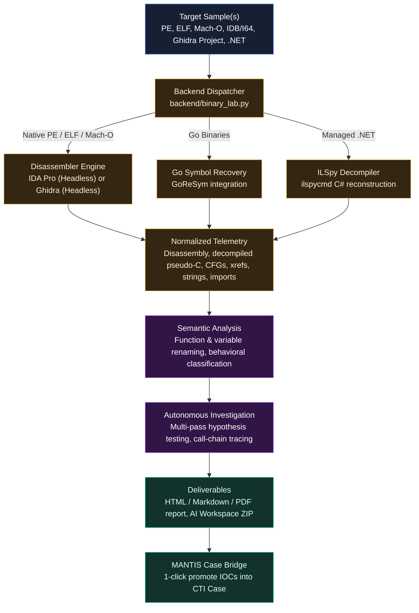

# AI Binary Analysis Lab

The **AI Binary Analysis Lab** is an integrated reverse-engineering and automated malware analysis workbench inside MANTIS. It bridges low-level static reverse engineering with modern AI reasoning, allowing analysts to triage native binaries, managed assemblies, and disassembler databases into decompiled source workspaces, semantic function catalogs, and comprehensive threat intelligence reports.

---

## Architecture Overview



---

## Supported File Formats & Tooling

| Binary Type | Supported Extensions / Formats | Primary Engine | Capabilities |
| --- | --- | --- | --- |
| **Windows Native** | `EXE`, `DLL`, `SYS`, `SCR`, `CPL` | IDA Pro / Ghidra | PE headers, imports, exports, resources, code disassembly, pseudo-C decompilation, CFGs. |
| **Linux Native** | `ELF` (32-bit & 64-bit), shared objects (`.so`) | IDA Pro / Ghidra | ELF headers, sections, PLT/GOT resolution, syscall mapping, strings, decompiler output. |
| **macOS Native** | `Mach-O` (x86_64, ARM64) | IDA Pro / Ghidra | Mach-O headers, load commands, Objective-C / Swift symbol resolution, decompilation. |
| **Disassembler Databases** | `.idb`, `.i64`, Ghidra `.gzf` / `.gpr` | IDA Pro / Ghidra | Direct ingestion of existing reverse-engineering projects; enriches existing user comments and types. |
| **Go Binaries** | Stripped Go executables | GoReSym + IDA/Ghidra | Restores stripped Go function names, package paths, types, and standard library boundaries. |
| **Managed .NET** | `.NET EXE`, `.NET DLL` | ILSpy (`ilspycmd`) | Reconstructs full C# source trees, CIL disassembly, assembly metadata, strings, and embedded resources. |

---

## Core Capabilities

### 1. Dual Disassembler Backends (IDA Pro & Ghidra)
* **IDA Pro (Headless)**: Uses headless IDA (`idat.exe` / `idat64.exe` on Windows, `idat` / `idat64` on Linux) driven by IDAPython automation scripts. If the Hex-Rays decompiler is licensed, MANTIS extracts high-level pseudo-C.
* **Ghidra (Headless)**: Automatic fallback and native alternative for environments without IDA Pro licenses. Invokes `support/analyzeHeadless` to perform disassembly, control-flow extraction, and decompiler analysis.
* **Automatic Detection**: Under **Engine Settings**, MANTIS tests and detects installed disassembler binaries automatically.

### 2. AI Semantic Renaming (Functions & Variables)
* **Function Renaming**: Replaces generic symbols (e.g., `sub_401080`) with descriptive names (e.g., `decrypt_c2_payload_rc4`, `inject_hollow_process`, `beacon_dns_query`) based on basic blocks, string references, crypto constants, and API calls.
* **Variable & Parameter Renaming**: Renames register arguments and stack variables into semantic identifiers without altering underlying stack offsets.
* **Address-Preserving Names**: Preserves the original virtual address in renamed labels for easy cross-referencing against disassemblers.

### 3. AI Workspace Export
Analysts and autonomous coding agents can download an offline **AI Workspace bundle** containing:
* `decompiled/`: Full C# source files or pseudo-C decompilation.
* `catalogs/`: Structured JSON catalogs indexing functions, local variables, strings, imports, exports, and call graphs.
* `cfg/`: Control Flow Graphs in DOT, SVG, and JSON formats for high-complexity routines.
* `asm/`: Complete linear assembly listing.
* `AGENTS.md` & `skills/*/SKILL.md`: Structured instructions for AI coding assistants to conduct further offline triage without executing malware.

### 4. Autonomous Binary Investigation
* Multi-pass analysis investigates binary behaviors without human prompting.
* Formulates hypotheses regarding binary capabilities (persistence, anti-analysis, C2 beacons, credential dumping).
* Traces data flow between functions to identify decryption keys, configuration structures, and communication protocols.

### 5. Multi-Format Report Generation
* **Formats**: Generates interactive **HTML**, **Markdown**, and printable **PDF** reports.
* **Sections**:
  * Executive Overview & Verdict.
  * Malware Capabilities Taxonomy (MITRE ATT&CK mapping).
  * High-Value Indicators (contacted IPs, domains, mutexes, file drops, registry keys).
  * Function catalog and decompiler highlights.
  * Extracted configuration blocks and decryption routines.
  * Suggested YARA detection rules.

### 6. MANTIS CTI Case Bridge
With a single click on **Create Case**, MANTIS takes the analyzed binary's cryptographic hashes (MD5, SHA-1, SHA-256), compile timestamp, and all extracted network/host IOCs and creates a new case in the MANTIS CTI Case workflow. Analysts can immediately run external enrichment across VirusTotal, Abuse.ch, Shodan, and MISP.

---

## Workbench Interface & Job Navigation

The workbench is organized into three primary views:

1. **New Analysis**:
   * **Input Mode**: Drag and drop binaries or specify a server-side directory.
   * **Engine Options**: Select disassembler backend (IDA Pro or Ghidra), toggle GoReSym, toggle .NET decompilation.
   * **Analysis Controls**: Enable function renaming, variable renaming, AI workspace generation, and autonomous analysis depth.
   * **Report Options**: Select output formats (HTML, Markdown, PDF) and AI token budgets.
2. **Jobs**:
   * Live queue monitoring active, completed, and failed analysis runs with progress percentages.
   * **Job Detail Sub-tabs**:
     * `Queue`: Sample metadata, architecture, file hashes, and disassembler exit codes.
     * `Analysis`: Investigation findings and executive brief with interactive Markdown / HTML preview.
     * `Functions`: Searchable table of renamed functions, addresses, and AI confidence ratings.
     * `Variables`: Catalog of renamed variables and parameter types.
     * `Disassembler Log`: Real-time streaming console output with noise filtering and auto-scroll.
     * `Reports`: One-click downloads for HTML, MD, and PDF reports.
     * `Events`: Chronological milestone event log.
     * `Artifacts`: Interactive file explorer allowing analysts to view or download individual CFGs, catalogs, disassembly listings, or the complete job ZIP archive.
     * `Create Case`: Bridge button to initialize a MANTIS CTI Case.
3. **Engine Settings**:
   * Configuration for IDA Pro executable path (`idat.exe` / `idat64.exe`).
   * Configuration for Ghidra install directory or `analyzeHeadless` executable.
   * GoReSym and ILSpy (`ilspycmd`) paths.
   * AI provider configuration: Toggle between shared MANTIS AI settings or custom endpoints.

---

## API Reference

| Endpoint | Method | Description |
| --- | --- | --- |
| `/api/binary-lab/status` | `GET` | Report engine availability (IDA, Ghidra, GoReSym, ILSpy status). |
| `/api/binary-lab/settings` | `GET`, `POST` | Retrieve or save Binary Lab disassembler and AI configuration settings. |
| `/api/binary-lab/test-provider` | `POST` | Test connection to the configured AI provider. |
| `/api/binary-lab/jobs` | `GET` | List all historical and active binary analysis jobs. |
| `/api/binary-lab/jobs/{job_id}` | `GET`, `DELETE` | Retrieve detailed status or delete a specific job and its uploaded files. |
| `/api/binary-lab/jobs/upload` | `POST` | Upload one or more sample binaries and queue an analysis job. |
| `/api/binary-lab/jobs/path` | `POST` | Queue an analysis job for files located in a local server path. |
| `/api/binary-lab/jobs/{job_id}/cancel` | `POST` | Cancel a running analysis job. |
| `/api/binary-lab/jobs/{job_id}/resume` | `POST` | Resume or re-run a cancelled or failed job. |
| `/api/binary-lab/jobs/{job_id}/catalogs` | `GET` | Retrieve JSON catalogs of functions, variables, strings, and imports. |
| `/api/binary-lab/jobs/{job_id}/ida-log` | `GET` | Retrieve the raw disassembler execution log. |
| `/api/binary-lab/jobs/{job_id}/artifacts` | `GET` | List all generated artifact files for a job. |
| `/api/binary-lab/jobs/{job_id}/artifacts/{path}` | `GET` | View or download a specific artifact file. |
| `/api/binary-lab/jobs/{job_id}/download` | `GET` | Download the complete AI Workspace and analysis results as a ZIP archive. |
| `/api/binary-lab/jobs/{job_id}/case` | `POST` | Bridge the analyzed sample and its extracted IOCs into a new MANTIS CTI Case. |

---

## Setup & Prerequisites

1. **Python Dependencies**:
   ```bash
   pip install headless-ida dnfile Pillow reportlab py-tlsh
   ```
2. **Disassembler Setup**:
   * **IDA Pro**: Ensure IDA Pro 7.x, 8.x, or 9.x is installed. In **Engine Settings**, select the folder containing `idat64.exe` (Windows) or `idat64` (Linux).
   * **Ghidra**: Install JDK 17+ and Ghidra. In **Engine Settings**, select the Ghidra root folder or the path to `support/analyzeHeadless.bat` (Windows) / `support/analyzeHeadless` (Linux).
   * **GoReSym**: Download the GoReSym binary from GitHub releases and specify its path in settings.
   * **ILSpy**: Install `ilspycmd` via `.NET tool install -g ilspycmd` and specify its path in settings.
