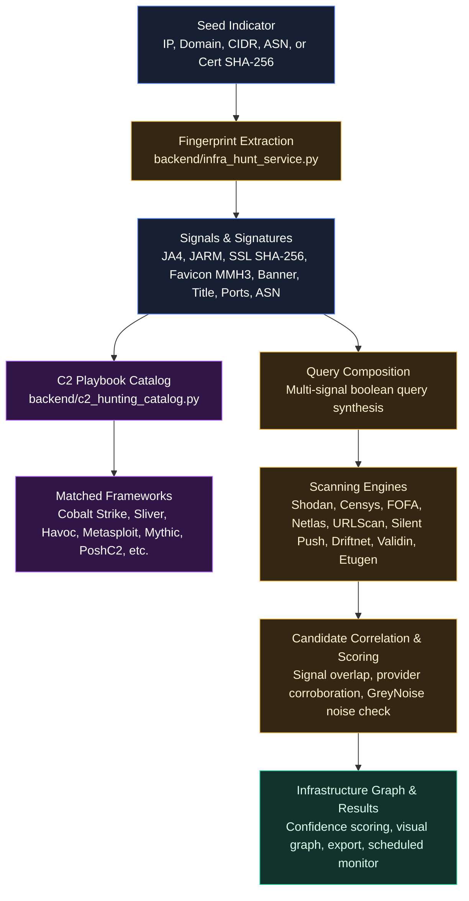

# Infrastructure Hunting & C2 Playbook Engine

MANTIS features an integrated **Infrastructure Hunting & C2 Playbook Engine** designed for proactive adversary tracking, threat-actor infrastructure discovery, and C2 framework identification. Instead of relying solely on reactive threat feeds, analysts can pivot from a single suspicious seed (IP, domain, ASN, CIDR, or certificate) into correlated clusters of adversary infrastructure across multiple internet scanning engines.

---

## Architecture Overview

---

## Core Capabilities

### 1. High-Fidelity Fingerprint Extraction
When an indicator is analyzed, MANTIS inspects both live and passive provider telemetry to extract distinctive infrastructure fingerprints:
* **TLS / SSL Certificates**: Certificate SHA-256 fingerprint, Subject DN, Issuer DN, Serial Number, and Subject Alternative Names (SANs).
* **Cryptographic Hashes & Signatures**:
  * **JARM**: Active 62-character TLS server fingerprint.
  * **JA4 / JA4X**: Modern transport and X.509 certificate fingerprints.
  * **Favicon MMH3**: MurmurHash3 integer hashes of HTTP favicon icons.
* **HTTP Service Telemetry**: HTTP server banners, exact header order, response codes, and HTML `<title>` tags.
* **Network & BGP Attributes**: Autonomous System Numbers (ASN), BGP prefixes, CIDR blocks, and open TCP/UDP port profiles.
* **Shared Infrastructure Suppression**: Built-in noise filters automatically suppress shared multi-tenant CDN/Cloud edge proxies (e.g., Cloudflare, Akamai, Fastly, AWS CloudFront, Azure Front Door, Google Cloud CDN, Vercel, Netlify) to prevent false-positive over-expansion.

### 2. C2 Hunting Playbook Catalog
The engine indexes curated, threat-intel-proven hunting queries compiled from industry research (including `Awesome-Malicious-Infra-Hunting-Queries` and `0x4bdo C2-Hunting`):
* **Framework Coverage**: Fingerprints for major adversary and red team frameworks, including **Cobalt Strike**, **Sliver**, **Havoc**, **Metasploit**, **Mythic**, **PoshC2**, **Brute Ratel (BNDAC2)**, **ShadowPad**, **AsyncRAT**, **Redline Stealer**, **Deimos C2**, **Pikabot**, and custom phishing panels.
* **Supported Query Engines**: Tailored query syntax for **Shodan**, **Censys Search**, **FOFA** (with Base64 payload encoding), **Netlas**, **URLScan.io**, and **Etugen WHOIS/DNS**.
* **Categorized Playbooks**: Filter queries by framework family, attack category (C2, Phishing, Proxy, Admin Panel), and search engine.
* **One-Click External Launch**: Queries feature direct hyperlinks with pre-encoded syntax to open results directly in the target engine's search portal.

### 3. Multi-Engine Query Composition & Hunter Deck
* **Hunter Deck Preview**: Prior to executing queries, analysts can generate a live preview of composite queries.
* **Query Composition**: Combines multiple non-generic signals (e.g., `JARM + Port + HTTP Title` or `Certificate SHA-256 + ASN`) into engine-specific query expressions to minimize noise and API credit consumption.
* **Provider Readiness Check**: Badges in the UI display which hunting providers are configured and ready based on available local or server-side API keys.

### 4. Candidate Scoring, Verification & Visualization
* **Corroboration Scoring**: Each candidate IP or domain is scored on a 0–100 scale based on:
  * Number of matching independent fingerprint signals.
  * Number of independent providers that returned the candidate.
  * Distance from known clean or shared infrastructure.
* **Confidence Bands**: Results are categorized into **High**, **Medium**, or **Low** confidence.
* **Anti-Noise Verification**: Built-in **GreyNoise** integration checks candidate IPs to flag benign internet scanners (e.g., Censys scanners, Shodan crawlers, research scans) and prevent false attribution.
* **Visual Infrastructure Graph**: Renders an interactive node graph illustrating the relationship between the root seed, intermediate pivot signals (cert, JARM, favicon, ASN), and correlated adversary nodes.
* **Export Options**: Export candidate lists to JSON, CSV, or pivot directly into MANTIS IOC Search and MANTIS AI Cases.

### 5. Scheduled Hunts & Infrastructure Monitoring
* **Persistent Hunt Database**: Saved hunts and their execution histories are stored in `backend/data/infra_hunts.db`.
* **Automated Recurrence**: Configure hunts to run automatically on a recurring schedule (e.g., every 24 hours).
* **Drift & Change Tracking**: MANTIS highlights newly identified nodes versus previously observed infrastructure, alerting analysts when threat actors deploy fresh C2 servers on matching infrastructure.
* **Custom Signature Packs**: Create, edit, and maintain custom signature definitions containing specific fingerprint rules.

---

## API Reference

| Endpoint | Method | Description |
| --- | --- | --- |
| `/api/infra-hunts/preview` | `POST` | Extract features from seed and generate composite hunting queries without querying third-party APIs. |
| `/api/infra-hunts/run` | `POST` | Execute composed queries across configured engines, score candidates, and generate the correlation graph. |
| `/api/infra-hunts/playbooks` | `GET` | Search and filter the curated C2 hunting playbook catalog (`q`, `engine`, `family`, `category`). |
| `/api/infra-hunts/etugen-templates` | `GET` | Retrieve Etugen query templates for WHOIS and passive DNS correlation. |
| `/api/infra-hunts/providers` | `GET` | Check API key readiness for all supported hunting engines. |
| `/api/infra-hunts` | `GET`, `POST` | List all saved hunts or create a new persistent hunt definition. |
| `/api/infra-hunts/{hunt_id}` | `GET`, `PUT`, `DELETE` | Retrieve, update, or delete a saved hunt configuration. |
| `/api/infra-hunts/{hunt_id}/run` | `POST` | Trigger an immediate execution run for a saved hunt. |
| `/api/infra-hunts/runs/{run_id}` | `GET` | Retrieve full results and candidate node details for a specific hunt run. |
| `/api/infra-hunts/run-due` | `POST` | Execute all scheduled hunts that have reached their recurrence interval. |
| `/api/infra-hunts/signatures` | `GET`, `POST` | List signature packs or create a custom signature pack. |
| `/api/infra-hunts/signatures/{id}` | `PUT`, `DELETE` | Update or delete a custom signature pack. |

---

## Typical Analyst Workflow

1. **Enter Seed**: On the IOC Search page or Infrastructure Hunt panel, enter a suspicious IP address or domain identified during an incident.
2. **Review Hunter Deck Preview**: Click **Hunt Infra** to extract fingerprints. Review extracted JA4, JARM, TLS certificate hashes, HTTP titles, and any matched C2 threat profiles from the playbook catalog.
3. **Select Engines**: Toggle the desired search engines (e.g., Shodan, Censys, FOFA, Netlas) based on your configured API keys.
4. **Execute Correlation**: Click **Run Expansion**. MANTIS queries the engines in parallel, deduplicates incoming hosts, checks GreyNoise for benign scanner status, and scores candidates.
5. **Inspect & Pivot**: Explore the interactive node graph. Inspect high-confidence candidate IPs, verify matching ports/certificates, and pivot candidate indicators into MANTIS AI or download the correlated IOC list.
6. **Set up Continuous Monitoring**: Save the query as a persistent hunt with a recurring schedule to automatically track new adversary servers as they come online.
