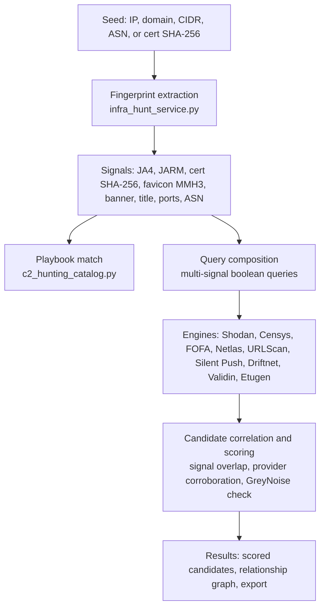

# Infrastructure Hunting

Infrastructure Hunting starts from one seed (IP, domain, CIDR, ASN, or certificate SHA-256) and looks for other servers that share its fingerprints. It is built around the C2 playbook catalog, so results can be matched to known adversary and red-team frameworks.

Sidebar tabs: **Infra Search** (`infra`), **Infra Pivot** (`infra-pivoting`), **Infra History** (`infra-history`), **OpenDir Hunt** (`opendir`), **C2 Hunting Catalog** (`c2-hunting-catalog`), **C2 & Tool Exposure** (`exposure-monitor`).

## How a hunt works

1. **Extract.** MANTIS reads live and passive telemetry for the seed and records its fingerprints.
2. **Match.** Fingerprints are checked against the C2 playbook catalog to suggest framework families.
3. **Compose.** Only non-generic signals are combined into engine queries (for example `JARM + port + HTTP title`), which keeps noise and API spend low.
4. **Correlate and score.** Candidates are scored 0–100 and banded High, Medium or Low.

### Fingerprints

- **TLS:** certificate SHA-256, subject and issuer DN, serial, SANs.
- **Hashes:** JARM, JA4 and JA4X, favicon MMH3.
- **HTTP:** server banner, header order, status code, `<title>`.
- **Network:** ASN, BGP prefix, CIDR, open ports.
- **Noise suppression:** shared CDN and edge proxies (Cloudflare, Akamai, Fastly, CloudFront, Azure Front Door, Google Cloud CDN, Vercel, Netlify) are filtered so they do not expand the hunt.

### Scoring

- Each candidate's score reflects the number of matching independent signals, the number of providers that returned it, and its distance from shared infrastructure.
- **GreyNoise** flags benign internet scanners so they are not attributed.

## Tutorial: correlate candidates from a seed

1. Open **Infra Search** (`infra`) and enter the seed in the search box: an IP, domain, CIDR, ASN or certificate SHA-256. The empty state reads "Start with an infrastructure indicator".
2. The **Expansion engines** panel lists Shodan, Censys, FOFA, ZoomEye, Netlas, Silent Push, Driftnet, Validin, Etugen and GreyNoise. Engines without a configured key are unavailable, so leave them off.
3. Click **Correlate candidates**. MANTIS extracts fingerprints, composes queries and returns scored candidates.
4. Review the candidates by score band. Check the shared fingerprints (JARM, JA4, certificate, favicon) that link each one to the seed.
5. Use **Infra Pivot** (`infra-pivoting`) to walk further from any candidate. Its export options are **JSON**, **CSV** and **STIX 2.1**.

Pivot settings in **Infra Pivot** are grouped as **Quick**, **Deep** and **Custom**, with fields for **Max Hop Depth (1–5)**, **Max Global Assets**, **Per-Pivot Limit**, **API Request Budget** and **Timeout (Seconds)**. Results are filtered by asset type (IP Addresses, Domains, URLs, TLS Certificates, Fingerprints, ASNs, WHOIS) and by confidence tier (High 70+, Medium 45–69, Low 22–44, Penalized/Noise under 22). **Hide Shared/CDN Noise** removes common CDN and proxy hosts.

Results are arranged in tabs: **Relationship Graph**, **Ranked Findings**, **Attribution & Playbook**, **Evidence & Provenance** and **History**.

## Pivoting

**Infra Pivot** starts from a known infrastructure value and walks outward through its relationships. Use it when you already have a set of servers and want their neighbours.

## Saved hunts and scheduling

Saved hunts and their runs are stored in `backend/data/infra_hunts.db`. The API supports saving a hunt, running it now, and running every hunt that is due (`POST /api/infra-hunts/run-due`, intended for a scheduler such as cron). Each run is compared with the previous one so new nodes are marked.

The **Infra History** tab (`infra-history`) is the place to review saved hunts. Recurrence settings are not exposed as a labelled control in the UI at this time; set them through the API or with a scheduled call to `run-due`.

## Signature packs

Custom signature packs hold your own fingerprint rules. Create and edit them through `/api/infra-hunts/signatures`.

## C2 Playbook Catalog

**C2 Hunting Catalog** is a searchable list of curated hunting queries compiled from public research (including Awesome-Malicious-Infra-Hunting-Queries and 0x4bdo C2-Hunting).

- **Families:** Cobalt Strike, Sliver, Havoc, Metasploit, Mythic, PoshC2, Brute Ratel, ShadowPad, AsyncRAT, Redline Stealer, Deimos C2, Pikabot, and phishing panels.
- **Engines:** Shodan, Censys, FOFA (Base64-encoded payloads), Netlas, URLScan.io, Etugen WHOIS and DNS.
- **Filters:** family, category (C2, Phishing, Proxy, Admin Panel), engine, and text search.
- Each query has a link that opens the engine's search with the query pre-filled.

## C2 & Tool Exposure

**C2 & Tool Exposure** (`exposure-monitor`) tracks saved exposure queries per tool. Add, edit or delete queries under a tool, then click **refresh** to rerun them. The Telegram toolkit also reads exposure data (see [Telegram Toolkit](telegram-toolkit.md)).

## OpenDir Hunt

**OpenDir Hunt** looks for open directory listings that match a seed or a pattern, and records hits in `backend/data/opendir_hunt.db`.

## API reference

| Endpoint | Method | Purpose |
| --- | --- | --- |
| `/api/infra-hunts/preview` | POST | Extract fingerprints and compose queries without calling engines. |
| `/api/infra-hunts/run` | POST | Run queries, score candidates, build the graph. |
| `/api/infra-hunts/playbooks` | GET | Search the playbook catalog (`q`, `engine`, `family`, `category`). |
| `/api/infra-hunts/etugen-templates` | GET | Etugen WHOIS and passive DNS templates. |
| `/api/infra-hunts/providers` | GET | Key readiness for each engine. |
| `/api/infra-hunts` | GET, POST | List or create saved hunts. |
| `/api/infra-hunts/{hunt_id}` | GET, PUT, DELETE | Read, update or delete a saved hunt. |
| `/api/infra-hunts/{hunt_id}/run` | POST | Run a saved hunt now. |
| `/api/infra-hunts/runs/{run_id}` | GET | Full results of one run. |
| `/api/infra-hunts/run-due` | POST | Run every hunt that is due. |
| `/api/infra-hunts/signatures` | GET, POST | List or create signature packs. |
| `/api/infra-hunts/signatures/{id}` | PUT, DELETE | Update or delete a signature pack. |

## Troubleshooting

| Symptom | Check |
| --- | --- |
| No candidates | The seed may be a shared CDN address. Turn on **Hide Shared/CDN Noise** and check the noise notes. |
| An engine is greyed out | Its key is missing. See **Settings -> API Keys**. |
| Many candidates are scanners | Add the GreyNoise key so benign scanners are flagged. |
| **Correlate candidates** stays disabled | Enter a seed first. |
