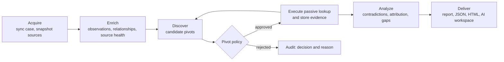

# MANTIS AI

MANTIS AI is the analyst assistant built into the workbench. It reads what is on screen (indicator, visible results, provider cards), the current case, and evidence you select. It can explain, rank pivots, compare entities, score attribution hypotheses, and draft reports. It works inside passive, read-only guardrails: it proposes actions, and every lookup it runs goes through the same source policy as a manual search.

## What it can do

| Capability | What it produces |
| --- | --- |
| Assist | Answers about the current result set or page. |
| Summarize Findings | Concise notes from raw provider cards. |
| Recommend Pivots | Ranked passive follow-ups; noisy or duplicate pivots suppressed with a reason. |
| Compare Relationship | Overlap and contradiction between two entities. |
| Attribution | Candidate actors with evidence categories, contradictions, missing evidence, and a confidence band. |
| Agent Investigation | Bounded next-step selection through approved frontend actions. |
| AEAD Case Run | Acquire, Enrich, Discover/Pivot, Analyze, Deliver. |
| Report | Case reports in Markdown, JSON, saved HTML, or an AI workspace ZIP. |
| YARA Assistant | Explain rules, interpret validation errors, suggest or apply safe fixes. |
| CTI AI | Summaries of CTI articles; Today's Intelligence brief and report. |
| Audit | Every tool decision, approval, operation and suppressed pivot is stored. |

## Setup

1. Open **Settings -> AI**.
2. Choose the provider and model, set the timeout and **Max Output To**.
3. Click **Test**.

If the banner says the provider used its whole output budget before writing any answer, the model spent its tokens on reasoning. Raise **Max Output To**.

Keys are per analyst in a personal vault, or server-side through environment variables. See [Getting Started](getting-started.md#5-add-api-keys).

## Tutorial 1: quick questions on a result page

1. Run a lookup in [IOC Search](ioc-search.md).
2. Open the **MANTIS AI** panel.
3. Ask, for example, "Which of these sources disagree about the hosting provider?"
4. The answer cites the cards it used. Open a card to check the raw record before you rely on it.

## Tutorial 2: a full case with the AEAD workflow

A case collects the evidence for one investigation.

1. From a result page, click **Sync Case**. This stores the current indicator, visible results and provider cards as the case root.
2. Click **Next Step** (or **Run Next**). MANTIS chooses one bounded pivot, checks it against the pivot policy, runs it through the passive source router, and stores the evidence.
3. Repeat **Next Step** while the pivots are useful. Each step appears on the timeline. Pivots rejected by policy are listed with the reason.
4. Click **Assess**. This runs contradiction checks, attribution support and confidence bands across the evidence, and lists gaps.
5. Click **Report** to draft the case report.
6. Export with **Export MD** or **Export JSON**, or generate a saved HTML report.

The workflow has five stages:

The pivot policy rejects placeholders, overly broad or noisy shared infrastructure, duplicates, and anything past the configured depth or budget.

## Tutorial 3: attribution hypothesis

1. Build the case first (Tutorial 2, steps 1 to 3).
2. Click **Attribution**. Review the candidate list.
3. For each candidate, read the evidence categories, the contradictions, and the missing-evidence list. A candidate with many gaps is a weak hypothesis, even at a high score.
4. Save the attribution notes with the case report. MANTIS does not state a final attribution.

## Tutorial 4: export an AI workspace for a coding agent

**Export AI Workspace** downloads a ZIP for offline work by a coding agent or an analyst:

- `AGENTS.md`, and a `CLAUDE.md` pointer to it.
- `case.json`, the normalized case.
- Focused JSON catalogs (observations, sources, pivots, timeline).
- The Markdown report.
- `skills/*/SKILL.md` workflows for investigation, evidence review, pivot planning, threat attribution (a six-category evidence model) and report writing.

The ZIP has no API keys. Its skills prohibit contacting indicators and unsupported enrichment claims.

## Tutorial 5: daily brief from Today's Intelligence

1. Open **Threat Intelligence -> Today's Intelligence**.
2. Set the source, severity, country, group and period filters.
3. Click **AI Daily Brief** for a short summary, or **Create Report (AI)** for a structured report.
4. Keep the report in History -> AI Reports.

## Tutorial 6: YARA help

In **YARA -> Rule Workbench**, use the MANTIS AI panel to explain a rule, paste a validation error for analysis, or request a fix. Safe syntax fixes can be applied automatically. Review the diff before you save. See [YARA](yara.md).

## Pivot families

The deterministic pivot registry (`backend/ai_pivot_registry.py`) maps pivot types to provider adapters:

- **Hash**: similar samples, network IOCs, YARA matches, family context, behavioural signatures, execution parents.
- **Domain**: passive DNS, current IPs, certificates, sibling domains, web reputation, threat pulses.
- **IP**: domains, ASN and BGP, certificates, services and ports, abuse and noise, threat pulses.
- **URL**: URL telemetry, payload hashes, redirect chains.
- **Infrastructure**: ASN infrastructure, CIDR exposed hosts, certificate-linked hosts.
- **Threat actor**: campaigns, infrastructure, ransomware victims.
- **Vulnerability**: exploits and PoCs, in-the-wild exploitation.
- **Malware and social**: family samples, social mentions, ThreatFox and MalwareBazaar checks.

## Limits and good practice

- The AI reads only the evidence it is given. Check claims against the source card before you publish.
- Model output varies. Re-run **Assess** after adding evidence rather than trusting an earlier answer.
- Do not paste secrets or unredacted victim data into a third-party AI provider unless your policy allows it.
- Every AI action is recorded in the audit trail. Review it before you sign off a report.
