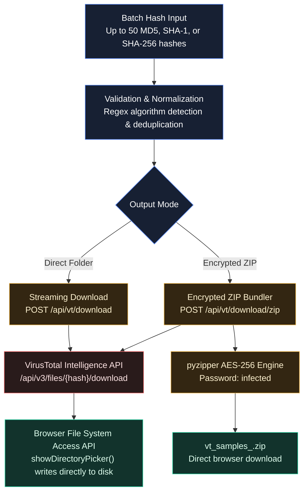

# VirusTotal Bulk Samples Downloader

The **VirusTotal Bulk Samples Downloader** in MANTIS is a high-throughput malware acquisition workbench. It enables threat analysts, reverse engineers, and incident responders to download batches of malicious binaries from VirusTotal by cryptographic hash, saving them directly to a local working folder or packaging them into an AES-encrypted ZIP archive.

---

## Architecture Overview



---

## Key Features

### 1. Flexible Input & Hash Detection
* **Batch Capacity**: Accepts up to **50 hashes per execution**.
* **Supported Algorithms**: Automatically detects and validates:
  * **MD5** (32 hexadecimal characters).
  * **SHA-1** (40 hexadecimal characters).
  * **SHA-256** (64 hexadecimal characters).
* **Flexible Delimiters**: Paste lists separated by spaces, commas, semicolons, or newlines.
* **Instant Validation**: The UI parses input on the fly, counts valid hashes, strips whitespace, and flags invalid tokens before submission.

### 2. Dual Output Modes

#### A. Direct to Local Folder
* Uses the modern browser **File System Access API** (`window.showDirectoryPicker()`).
* Prompts the analyst to select a local destination folder on disk.
* Each sample is streamed directly from the VirusTotal API through the MANTIS backend into the target directory as `<hash>.bin`.
* **Zero Browser Memory Bloat**: Files stream in real-time without buffering large multi-megabyte payloads in browser RAM, making it optimal for large executable and installer downloads.

#### B. Password-Protected Encrypted ZIP
* Bundles all acquired samples into a single archive named `vt_samples_<timestamp>.zip`.
* Encrypted using **AES-256** via Python's `pyzipper` library.
* Standard security password: `infected`.
* Ensures live malware binaries cannot be inadvertently executed on the host filesystem or triggered by local endpoint protection during transit.

### 3. Real-Time Status & Diagnostics
* **Live Progress Bar**: Displays execution percentage and current sample in flight.
* **Results Table**:
  * **Hash**: Monospace indicator preview.
  * **Type**: Identified hash algorithm badge.
  * **Status**: Visual badge (`Success`, `Failed`, `Downloading`).
  * **Details**: Explicit diagnostic feedback for failed items:
    * `404 Not Found`: Binary is known to VT metadata but the physical sample file is not stored in the repository.
    * `401 / 403 Forbidden`: The supplied VT API key is missing or lacks sample download entitlements.
    * `429 Rate Limit`: The hourly or daily sample download quota has been exhausted.
    * `504 Gateway Timeout`: VirusTotal upstream download request timed out.
* **Header Reporting**: Backend emits `X-VT-Failed-Samples` and `X-VT-Succeeded-Count` HTTP response headers for automated tracking.

### 4. Analyst Clipboard Helpers
* **Copy Failed**: Copies all failed hashes to the clipboard with one click, making it easy to paste them into alternative repositories (e.g., MalwareBazaar, MalShare, Triage).
* **Copy Success**: Copies all successfully downloaded hashes for documentation or case notes.

### 5. Safety Guardrail & Isolation Consent
* To avoid accidental downloads on unhardened analyst workstations, the interface enforces a mandatory consent checkbox:
  > *"I understand these files may contain active malware and will handle them in an isolated environment."*
* The download action remains locked until the consent box is checked.

### 6. Seamless Workflow Integration
* **VT Live Hunt Monitoring**: When monitoring VirusTotal Live Hunts or Notifications in MANTIS, clicking **Send to Downloader** on any detected threat instantly navigates to the Samples Downloader tab and pre-fills the hash.
* **IOC Search**: Direct links from VirusTotal IOC lookup cards let analysts pivot from hash intelligence to sample acquisition.
* **AI Binary Analysis Lab Handoff**: Downloaded samples can be uploaded immediately into the **AI Binary Analysis Lab** for static decompilation and automated reverse engineering.

---

## API Reference

### 1. Download Single Sample
```http
POST /api/vt/download
Content-Type: application/json

{
  "file_hash": "275a021bbfb6489e54d471899f7db9d1663fc695ec2fe2a2c4538aabf651fd0f",
  "vt_key": "YOUR_VT_ENTERPRISE_KEY"
}
```
* **Response**: Binary stream (`application/octet-stream`) with `Content-Disposition: attachment; filename="<hash>.bin"`.

### 2. Download Batch as Encrypted ZIP
```http
POST /api/vt/download/zip
Content-Type: application/json

{
  "hashes": [
    "275a021bbfb6489e54d471899f7db9d1663fc695ec2fe2a2c4538aabf651fd0f",
    "c0202cf6aeab8437a60d14b418f5d7ff"
  ],
  "vt_key": "YOUR_VT_ENTERPRISE_KEY",
  "password": "infected"
}
```
* **Response**: ZIP archive stream (`application/zip`) with custom diagnostic headers:
  * `X-VT-Failed-Samples`: Comma-separated list of hashes that failed.
  * `X-VT-Succeeded-Count`: Integer count of successful downloads.

---

## Prerequisites & Key Requirements

1. **VirusTotal API Entitlements**:
   * Downloading binary sample files requires a **VirusTotal Premium / Intelligence / Enterprise** API key.
   * Free Public Community API keys can query metadata and detection ratios but cannot download physical binaries from VirusTotal (`HTTP 403 Forbidden`).
2. **Key Configuration**:
   * Configure your API key once in **Settings -> API Keys -> VirusTotal**, or provide it via the `IOCINTEL_VT_KEY` environment variable.
   * The downloader automatically retrieves your configured key from local storage.
